[⬅ Profil](../README.md) › Enseignement › **Méthodes numériques pour la mécanique**

<div align="center">

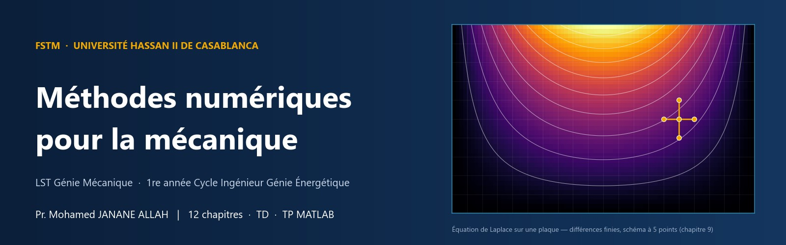

<br/>

Résoudre sur ordinateur les problèmes que la mécanique ne sait pas résoudre à la main :<br/>
**systèmes linéaires et non linéaires**, **équations aux dérivées partielles** par différences finies,
**équations différentielles ordinaires**.

[](methodes-numeriques/Chapitre_00_Introduction_generale/1_Cours_chapitre_00.pdf)
[](https://drive.google.com/file/d/1dc97-wJZVYQ1Gan3rmW4U6hYal3hQO9W/view)

<sub>🎓 Conçu pour les étudiants de la FSTM — Université Hassan II de Casablanca · 🔒 vidéos accessibles avec le compte universitaire UH2C</sub>

<table>
<tr>
<td align="center" width="20%"><b>📚 12 modules</b><br><sub>144 pages de cours</sub></td>
<td align="center" width="20%"><b>🎥 18 vidéos</b><br><sub>cours et ateliers TP</sub></td>
<td align="center" width="20%"><b>🔬 6 TP MATLAB</b><br><sub>6 corrigés en scripts</sub></td>
<td align="center" width="20%"><b>📝 8 sujets d'examen</b><br><sub>archive en accès libre</sub></td>
<td align="center" width="20%"><b>⏱️ 60 h · 48 h</b><br><sub>LST GM · Cycle GE · 11 TD</sub></td>
</tr>
</table>

[**À propos**](#-à-propos) · [**GM / GE**](#-deux-parcours--gm-et-ge) · [**Programme**](#-programme-du-module) · [**Examens**](#-examens) · [**Enseignant**](#-enseignant) · [**Questions fréquentes**](#-questions-fréquentes) · [**🎮 Jeux**](#-jeux-interactifs)

</div>

---

## 📌 À propos

Ce module donne les outils numériques qui permettent de résoudre, sur ordinateur, les problèmes
que la mécanique ne sait pas résoudre à la main : **systèmes linéaires** (méthodes directes et
itératives), **systèmes non linéaires**, **équations aux dérivées partielles** par différences
finies, et **équations différentielles ordinaires**.

#### Ce que vous apprendrez

<table>
<tr><td width="50%" valign="top">✔️ Choisir une méthode adaptée à la taille et à la structure du problème</td><td width="50%" valign="top">✔️ Estimer la précision d'un résultat et reconnaître un calcul qui diverge</td></tr>
<tr><td width="50%" valign="top">✔️ Programmer ces méthodes en MATLAB et valider un schéma sur un cas test analytique</td><td width="50%" valign="top">✔️ Interpréter physiquement les conditions de stabilité (CFL, critères de convergence)</td></tr>
</table>

#### Compétences que vous allez acquérir


#### Détails à connaître

| 🎓 Public | ⏱️ Volume | 🧩 Prérequis | 💻 Logiciel | 🗣️ Langue |
|---|---|---|---|---|
| LST Génie Mécanique · 1ʳᵉ année du Cycle d'Ingénieur Génie Énergétique (FSTM) | 60 h en LST GM · 48 h en Cycle GE ([détail](#-deux-parcours--gm-et-ge)) | Algèbre linéaire, analyse (développements de Taylor), bases de MATLAB | MATLAB | Français |

---

## 🎓 Deux parcours : GM et GE

Le module est suivi par deux publics de la FSTM. **Le contenu scientifique est le même** : les douze modules, les démonstrations, les méthodes et les critères de validation. Ce qui change en Cycle d'Ingénieur Génie Énergétique : **le volume horaire** (48 h au lieu de 60 h), **les TP** (cinq au lieu de six) et **le contexte des exemples**, tirés de l'énergétique.

| | 🔧 LST Génie Mécanique | ⚡ Cycle d'Ingénieur GE, 1ʳᵉ année |
|---|---|---|
| **Volume total** | **60 h** | **48 h** · 16 séances de 3 h |
| Cours | 28 h | 24 h |
| TD | 14 h | 9 h |
| TP | 18 h · 6 séances, TP1 à TP6 | 15 h · 5 séances, TP1 à TP5 |
| 🚩 Introduction · module 00 | sans horaire séparé | 1 h de cours, séance d'ouverture |
| 🧮 Partie I · modules 01 à 04 | 9 h de cours · 6 h de TD · TP1, TP2, TP3 | 7 h de cours · 4 h de TD · TP1, TP2, TP3 |
| 🌡️ Partie II · modules 05 à 11 | 19 h de cours · 8 h de TD · TP4, TP5, TP6 | 16 h de cours · 5 h de TD · TP4, TP5 |

#### Les TP de chaque parcours

| TP | Méthode | 🔧 LST GM | ⚡ Cycle GE |
|:-:|---|---|---|
| **TP1** | Méthode directe : Gauss avec pivotage, conditionnement | le banc d'amortisseurs | réseau thermique d'un bâtiment ou mur multicouche |
| **TP2** | Méthodes itératives | la paroi d'un four | identique |
| **TP3** | Newton | le système de pompage | identique (pompage et Colebrook) |
| **TP4** | EDO non linéaire : Euler et Runge-Kutta | le refroidissement d'une paroi de four | identique |
| **TP5** | Poisson 2D | la salle de sport | champ de température d'une salle ou d'un bâtiment, conditions aux limites mixtes |
| **TP6** | Système d'EDO | les attracteurs de Lorenz | — (pas de TP6) |

<sub>Les énoncés de TP en ligne sont communs aux deux parcours ; les versions énergétiques du TP1 et du TP5 sont prévues pour le GE.</sub>

<details>
<summary><b>⚡ Le programme du Cycle GE, module par module (24 h de cours, 9 h de TD)</b></summary>
<br/>

| Module | Cours | TD | Applications en énergétique |
|---|:-:|:-:|---|
| **00** · Introduction générale | 1 h | – | Quatre cas chiffrés : pompage, solaire, four, réseau. |
| **01** · Rappels numériques : erreurs, normes et conditionnement | 1 h | 1 h | Bilans d'énergie et rendements : soustraction de grandeurs voisines, arrondi, conditionnement d'un bilan thermique. |
| **02** · Systèmes linéaires : méthodes directes | 2 h | 1 h | Réseau thermique nodal d'un bâtiment multizone ; réseau hydraulique maillé. |
| **03** · Systèmes linéaires : méthodes itératives | 2 h | 1 h | Conduction 2D dans un four ou une plaque : grands systèmes creux (Jacobi, Gauss-Seidel, SOR). |
| **04** · Systèmes non linéaires | 2 h | 1 h | Colebrook (pertes de charge), bilan radiatif en T⁴, point de fonctionnement pompe-réseau : Newton. |
| **05** · Généralités sur les EDP en mécanique et classification | 1,5 h | 0,5 h | Chaleur, convection-diffusion, Poisson, ondes : un phénomène énergétique pour chaque type d'EDP. |
| **06** · Principe de la méthode des différences finies | 2,5 h | 0,5 h | Paroi de four (fil rouge), ailette : de l'équation au système A T = b. |
| **07** · Consistance, stabilité, convergence | 2,5 h | 1 h | Seuil r ≤ 1/2 sur la paroi réfractaire ; CFL pour le transport de chaleur par un fluide. |
| **08** · Équation de la chaleur | 3 h | 1 h | Paroi, ailette, stockage thermique ; schémas explicite, implicite, θ. |
| **09** · Équation de Laplace-Poisson et advection-diffusion | 3 h | 1 h | Champ de température d'un bâtiment (2D) ; échangeur et nombre de Péclet. |
| **10** · Équation des ondes | 1,5 h | 0,5 h | Vibrations de tuyauteries et d'aubes ; acoustique d'un conduit. |
| **11** · Résolution numérique des équations différentielles ordinaires | 2 h | 0,5 h | Dynamique thermique d'un four ou d'un ballon de stockage ; raideur et choix du pas. |
| **Total** | **24 h** | **9 h** | TP : 15 h, en 5 séances |

Le cours du GE est plus dense : même contenu en 24 h au lieu de 28 h. Tous les TD restent disponibles ; certains sont traités en demi-séance, les autres en travail personnel guidé.

</details>

---

## 📚 Programme du module

Il y a **12 modules** dans ce cours, en trois parties précédées d'une introduction. Chaque module
donne accès directement à ses supports : un clic sur un bouton ouvre le document ou la vidéo.

<sub>🔵 cours (PDF) · 🟣 TD · 🔴 énoncé de TP · 🟢 corrigé (scripts MATLAB) · 🟠 vidéo (compte UH2C) · 🟡 jeux interactifs</sub>

### 🚩 Introduction

<sub>1 module · 8 pages de cours</sub>

#### Module 00 · Introduction générale

Pourquoi le calcul numérique en mécanique, et à quoi il sert concrètement dans le métier d'ingénieur. Présentation des exemples fils conducteurs du module.

[](methodes-numeriques/Chapitre_00_Introduction_generale/1_Cours_chapitre_00.pdf)
[](https://drive.google.com/file/d/18AdF62vRubU5swh_zy52d6AvmlzcVybn/view)

### 🧮 Partie I — Systèmes algébriques

<sub>4 modules · 59 pages de cours</sub>

Résoudre *Ax = b*, puis *F(x) = 0* : les briques sur lesquelles repose tout le reste du module.

#### Module 01 · Rappels numériques : erreurs, normes et conditionnement

Un ordinateur ne calcule jamais exactement : erreurs d'arrondi, normes vectorielles et matricielles, conditionnement d'une matrice.

[](methodes-numeriques/Chapitre_01_Rappels_numeriques/1_Cours_chapitre_01.pdf)
[](methodes-numeriques/Chapitre_01_Rappels_numeriques/3_TD01_enonce.pdf)
[](https://drive.google.com/file/d/13uDHLzPXsp9XpujDGj60SXAgyNtyW84X/view)

#### Module 02 · Systèmes linéaires : méthodes directes

Résolution de Ax = b en un nombre fini d'opérations — la brique de base de tout calcul par éléments finis.

[](methodes-numeriques/Chapitre_02_Systemes_lineaires_directs/1_Cours_chapitre_02.pdf)
[](methodes-numeriques/Chapitre_02_Systemes_lineaires_directs/3_TD02_enonce.pdf)
[](methodes-numeriques/Chapitre_02_Systemes_lineaires_directs/4_TP1_enonce.pdf)
[](methodes-numeriques/Chapitre_02_Systemes_lineaires_directs/4_TP1_corrige_scripts_MATLAB.zip)
[](https://drive.google.com/file/d/19rK9Xc4acZQ77KQnYxwGSc7pkNBj1MKc/view)
[](https://drive.google.com/file/d/1kmhqkhzH1HCGq9E5eakniAzW5kthOiE-/view)
[](https://janane-allah.github.io/jeux/tp1/)

#### Module 03 · Systèmes linéaires : méthodes itératives

Pour les grands systèmes creux issus d'un maillage fin, là où l'élimination de Gauss coûte trop cher et détruit le caractère creux (fill-in).

[](methodes-numeriques/Chapitre_03_Systemes_lineaires_iteratifs/1_Cours_chapitre_03.pdf)
[](methodes-numeriques/Chapitre_03_Systemes_lineaires_iteratifs/3_TD03_enonce.pdf)
[](methodes-numeriques/Chapitre_03_Systemes_lineaires_iteratifs/4_TP2_enonce.pdf)
[](methodes-numeriques/Chapitre_03_Systemes_lineaires_iteratifs/4_TP2_corrige_scripts_MATLAB.zip)
[](https://drive.google.com/file/d/19Q7Vj94XDHRTuFz_X4l-3xFFBQQcJwZI/view)
[](https://drive.google.com/file/d/1dw82htm3bDXOKr3v-Jziv230Bs23vpe0/view)
[](https://janane-allah.github.io/jeux/tp2/)

#### Module 04 · Systèmes non linéaires

Résoudre F(x) = 0 quand la physique cesse d'être linéaire : pertes de charge quadratiques, ressort durcissant, grandes déformations.

[](methodes-numeriques/Chapitre_04_Systemes_non_lineaires/1_Cours_chapitre_04.pdf)
[](methodes-numeriques/Chapitre_04_Systemes_non_lineaires/3_TD04_enonce.pdf)
[](methodes-numeriques/Chapitre_04_Systemes_non_lineaires/4_TP3_enonce.pdf)
[](methodes-numeriques/Chapitre_04_Systemes_non_lineaires/4_TP3_corrige_scripts_MATLAB.zip)
[](https://drive.google.com/file/d/125--JQ7p31u2xEMZVsSO3x2MCeXNOXYA/view)
[](https://drive.google.com/file/d/1b4vdrutxz_yeuuil7ytYzb3D7f6wrNUL/view)
[](https://janane-allah.github.io/jeux/tp3/)

### 🌡️ Partie II — EDP et différences finies

<sub>6 modules · 63 pages de cours</sub>

De la classification des EDP aux trois équations modèles de la mécanique : chaleur, Laplace-Poisson, ondes.

#### Module 05 · Généralités sur les EDP en mécanique et classification

L'inconnue n'est plus un vecteur mais un champ. Classification elliptique / parabolique / hyperbolique et conditions aux limites associées.

[](methodes-numeriques/Chapitre_05_Generalites_EDP/1_Cours_chapitre_05.pdf)
[](methodes-numeriques/Chapitre_05_Generalites_EDP/3_TD05_enonce.pdf)
[](https://drive.google.com/file/d/1wxEG6bzlLQPGz-evjzRmrmuqnVQsqqgs/view)

#### Module 06 · Principe de la méthode des différences finies

L'étape décisive : remplacer les dérivées, objets continus, par des quantités calculables sur ordinateur.

[](methodes-numeriques/Chapitre_06_Principe_differences_finies/1_Cours_chapitre_06.pdf)
[](methodes-numeriques/Chapitre_06_Principe_differences_finies/3_TD06_enonce.pdf)
[](https://drive.google.com/file/d/1F-IuYtpVuRNhaj7w13zxnSUldtZj1PoB/view)

#### Module 07 · Consistance, stabilité, convergence

Pourquoi un schéma parfaitement construit sur le papier peut produire des résultats absurdes — des oscillations qui grandissent jusqu'à faire déborder les calculs.

[](methodes-numeriques/Chapitre_07_Consistance_stabilite_convergence/1_Cours_chapitre_07.pdf)
[](methodes-numeriques/Chapitre_07_Consistance_stabilite_convergence/3_TD07_enonce.pdf)
[](https://drive.google.com/file/d/1AT_64YZW3ebVt21abcGkxcZUoLHFnnkg/view)

#### Module 08 · Équation de la chaleur

Un problème physique résolu de bout en bout : la paroi de four en régime transitoire, de l'état initial jusqu'à l'équilibre.

[](methodes-numeriques/Chapitre_08_Equation_chaleur/1_Cours_chapitre_08.pdf)
[](methodes-numeriques/Chapitre_08_Equation_chaleur/3_TD08_enonce.pdf)
[](https://drive.google.com/file/d/18wNa17e4CPXprrvWbSh1HTMUlAU2F5dD/view)

#### Module 09 · Équation de Laplace-Poisson et advection-diffusion

Discrétisation 2D complète (Dirichlet puis Neumann), validation sur un cas test analytique, puis introduction de l'advection-diffusion.

[](methodes-numeriques/Chapitre_09_Laplace_Poisson_advection/1_Cours_chapitre_09.pdf)
[](methodes-numeriques/Chapitre_09_Laplace_Poisson_advection/3_TD09_enonce.pdf)
[](methodes-numeriques/Chapitre_09_Laplace_Poisson_advection/4_TP5_enonce.pdf)
[](methodes-numeriques/Chapitre_09_Laplace_Poisson_advection/4_TP5_corrige_scripts_MATLAB.zip)
[](https://drive.google.com/file/d/1YinQ_oHGrndBm2nsGVBWTBDI62pUBbBE/view)
[](https://drive.google.com/file/d/1qhSEHFj44XbFneGbJCBylgvrMxVg7l5O/view)
[](https://janane-allah.github.io/jeux/tp5/)

#### Module 10 · Équation des ondes

La corde vibrante et sa condition de stabilité — la condition CFL, avec son interprétation géométrique remarquable.

[](methodes-numeriques/Chapitre_10_Equation_ondes/1_Cours_chapitre_10.pdf)
[](methodes-numeriques/Chapitre_10_Equation_ondes/3_TD10_enonce.pdf)
[](https://drive.google.com/file/d/1IQh3d69BFptw47AmVj_zgeMaxRPnpFTB/view)

### 📈 Partie III — Équations différentielles ordinaires

<sub>1 module · 14 pages de cours</sub>

Retour au temps : Euler, Runge-Kutta et la question de la stabilité du pas de temps.

#### Module 11 · Résolution numérique des équations différentielles ordinaires

L'évolution temporelle des systèmes à nombre fini de degrés de liberté : oscillateurs, mécanismes, circuits équivalents.

[](methodes-numeriques/Chapitre_11_EDO_Euler_Runge_Kutta/1_Cours_chapitre_11.pdf)
[](methodes-numeriques/Chapitre_11_EDO_Euler_Runge_Kutta/3_TD11_enonce.pdf)
[](methodes-numeriques/Chapitre_11_EDO_Euler_Runge_Kutta/4_TP4_enonce.pdf)
[](methodes-numeriques/Chapitre_11_EDO_Euler_Runge_Kutta/4_TP6_enonce.pdf)
[](methodes-numeriques/Chapitre_11_EDO_Euler_Runge_Kutta/4_TP4_corrige_scripts_MATLAB.zip)
[](methodes-numeriques/Chapitre_11_EDO_Euler_Runge_Kutta/4_TP6_corrige_scripts_MATLAB.zip)
[](https://drive.google.com/file/d/1OZqZkwXP--N1ZcmgipRbnzRsleo4AnD8/view)
[](https://drive.google.com/file/d/1GeBDuM-bsHzrqXIGovBEPhuHptdbIkzp/view)
[](https://drive.google.com/file/d/1FFd2tp73XQvZY2wPG-ukHws2T4iTNNlx/view)
[](https://janane-allah.github.io/jeux/tp4/)
[](https://janane-allah.github.io/jeux/tp6/)

---

## 📝 Examens

Sujets des sessions précédentes, en accès libre, pour s'entraîner dans les conditions de
l'épreuve (durée : 2 h). Les sujets **A** et **B** posent les mêmes questions avec des
données numériques différentes.

### 🗂️ Année universitaire 2025/2026

| Épreuve | Programme | 📄 Sujets |
|---|---|:-:|
| **Examen — Partie I** | Systèmes d'équations linéaires et non linéaires | [Sujet A](methodes-numeriques/Examens/examen_partie1_2025_2026_sujetA.pdf) · [Sujet B](methodes-numeriques/Examens/examen_partie1_2025_2026_sujetB.pdf) |
| **Examen — Partie II** | Méthodes des différences finies | [Sujet A](methodes-numeriques/Examens/examen_partie2_2025_2026_sujetA.pdf) · [Sujet B](methodes-numeriques/Examens/examen_partie2_2025_2026_sujetB.pdf) |
| **Examen de préparation n°1** | Parties I et II — niveau difficile | [PDF](methodes-numeriques/Examens/examens_preparation_2025_2026/examen_preparation_1_2025_2026.pdf) |
| **Examen de préparation n°2** | Parties I et II — niveau difficile | [PDF](methodes-numeriques/Examens/examens_preparation_2025_2026/examen_preparation_2_2025_2026.pdf) |

### 🗂️ Année universitaire 2024/2025

| Épreuve | Programme | 📄 Sujets |
|---|---|:-:|
| **Examen — Parties I et II** | Systèmes d'équations et méthodes des différences finies | [Sujet A](methodes-numeriques/Examens/examen_mixte_2024_2025_sujetA.pdf) · [Sujet B](methodes-numeriques/Examens/examen_mixte_2024_2025_sujetB.pdf) |

> 💡 **Conseil :** traitez un sujet en temps limité avant de relire le cours, puis comparez avec
> vos TD. Les examens de préparation sont de **niveau difficile** : un bon test avant l'épreuve.

---

## 👤 Enseignant

<table>
<tr>
<td width="130" align="center" valign="top"></td>
<td valign="top">
<b>Pr. Mohamed JANANE ALLAH</b>, PhD — Maître de Conférence<br/>
Faculté des Sciences et Techniques de Mohammedia (FSTM) — Université Hassan II de Casablanca<br/><br/>
🔬 Recherche : modélisation numérique des structures — plaques à gradient fonctionnel (FGM), méthodes hybrides éléments finis – sans maillage, réseaux de neurones.<br/>
📚 Autre cours : <a href="licence-pro-hydraulique.md">Systèmes hydrauliques</a> — Licence Professionnelle IMPI, ENSAM Casablanca.<br/>
🌐 <a href="https://janane-allah.github.io">Site personnel</a> · <a href="https://janane-allah.github.io/publications/">Publications</a> · <a href="mailto:mohamedjanane147@gmail.com">mohamedjanane147@gmail.com</a>
</td>
</tr>
</table>

🏛️ **Proposé par** la Faculté des Sciences et Techniques de Mohammedia — Université Hassan II de Casablanca · 📍 BP 146, Mohammedia 28806, Maroc

---

## ❓ Questions fréquentes

<details>
<summary><b>À qui s'adresse ce module ?</b></summary>
<br/>

Le module est **mutualisé**, à la FSTM — UH2C, entre la **LST Génie Mécanique** et la **1ʳᵉ année du Cycle
d'Ingénieur Génie Énergétique (GE)** : les outils numériques sont exactement les mêmes de part et d'autre.
Changent les applications, le volume horaire et les TP : 60 h et six TP en LST GM, 48 h et cinq TP en Cycle GE
([détail des deux parcours](#-deux-parcours--gm-et-ge)).

</details>

<details>
<summary><b>Comment accéder aux vidéos ?</b></summary>
<br/>

🔒 Les vidéos sont **réservées aux étudiants de l'Université Hassan II de Casablanca**. Connectez-vous à votre
**compte universitaire** avant d'ouvrir un lien vidéo : depuis un compte personnel, Google affichera une
demande d'autorisation. Si l'accès vous est refusé alors que vous êtes bien inscrit au module, écrivez-moi.

Commencez par la **[vidéo d'accroche](https://drive.google.com/file/d/1dc97-wJZVYQ1Gan3rmW4U6hYal3hQO9W/view)** : où le calcul numérique intervient réellement dans le
métier d'ingénieur mécanicien.

</details>

<details>
<summary><b>Quels supports puis-je télécharger ?</b></summary>
<br/>

Tous les PDF — cours, TD, énoncés de TP, sujets d'examen — et les **corrigés de TP** (scripts MATLAB, en zip)
sont en accès libre sur cette page. Les vidéos se regardent en ligne, avec le compte universitaire.

</details>

<details>
<summary><b>Comment travailler un chapitre ?</b></summary>
<br/>

| Étape | Support | Objectif |
|:-:|---|---|
| 1️⃣ | 📄 **Cours** | Lire le chapitre avant la séance — les notions s'enchaînent, chaque chapitre s'appuie sur le précédent. |
| 2️⃣ | 📝 **TD** | Faire les exercices à la main : c'est là que les méthodes se comprennent vraiment. |
| 3️⃣ | 🔬 **TP** | Programmer la méthode en MATLAB et la confronter à un cas test dont on connaît la solution. |

</details>

<details>
<summary><b>Comment préparer l'examen ?</b></summary>
<br/>

Traitez un sujet de l'[archive](#-examens) en temps limité (2 h) avant de relire le cours, puis comparez avec
vos TD. Les examens de préparation sont de niveau difficile : un bon test avant l'épreuve.

</details>

<details>
<summary><b>Comment les fichiers sont-ils organisés ?</b></summary>
<br/>

```
cours/methodes-numeriques/
├── Chapitre_00_Introduction_generale/
├── Chapitre_01_Rappels_numeriques/
├── Chapitre_02_Systemes_lineaires_directs/
├── Chapitre_03_Systemes_lineaires_iteratifs/
├── Chapitre_04_Systemes_non_lineaires/
├── Chapitre_05_Generalites_EDP/
├── Chapitre_06_Principe_differences_finies/
├── Chapitre_07_Consistance_stabilite_convergence/
├── Chapitre_08_Equation_chaleur/
├── Chapitre_09_Laplace_Poisson_advection/
├── Chapitre_10_Equation_ondes/
├── Chapitre_11_EDO_Euler_Runge_Kutta/
└── Examens/
```

Dans chaque dossier : `1_Cours_chapitre_XX.pdf`, `3_TDXX_enonce.pdf`, `4_TPX_enonce.pdf`,
et, quand il existe, `4_TPX_corrige_...` (corrigé librement téléchargeable).
Sujets d'examen dans `Examens/` : `examen_<partie1|partie2|mixte>_AAAA_AAAA_sujetX.pdf`,
`examen_preparation_N_AAAA_AAAA.pdf`.

</details>

---

## 🎮 Jeux interactifs

Des jeux, dans le navigateur, pour **manipuler un TP avant de le programmer** : chaque jeu correspond à une
manipulation de l'énoncé. Tous les nombres affichés sont calculés en direct par le code MATLAB du TP, porté
ligne pour ligne en JavaScript : ce sont les mêmes que dans MATLAB.

### TP1 · Module 02 — le banc d'amortisseurs (méthodes directes)

<table>
<tr>
<td width="33%" valign="top" align="center"><a href="https://janane-allah.github.io/jeux/tp1/#jeu-1">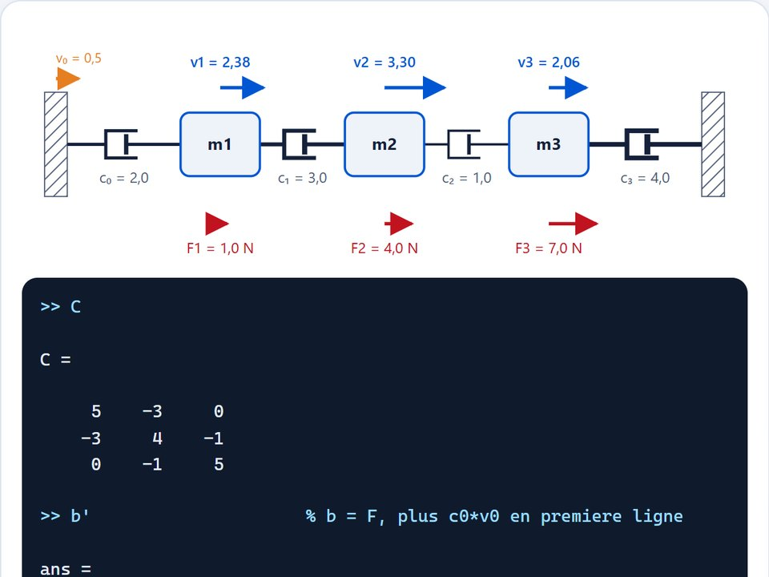</a><br/><b>1 · Le banc d'essai</b><br/><sub>Assembler C, bâti mobile, matrice singulière</sub><br/><a href="https://janane-allah.github.io/jeux/tp1/#jeu-1"></a></td>
<td width="33%" valign="top" align="center"><a href="https://janane-allah.github.io/jeux/tp1/#jeu-2">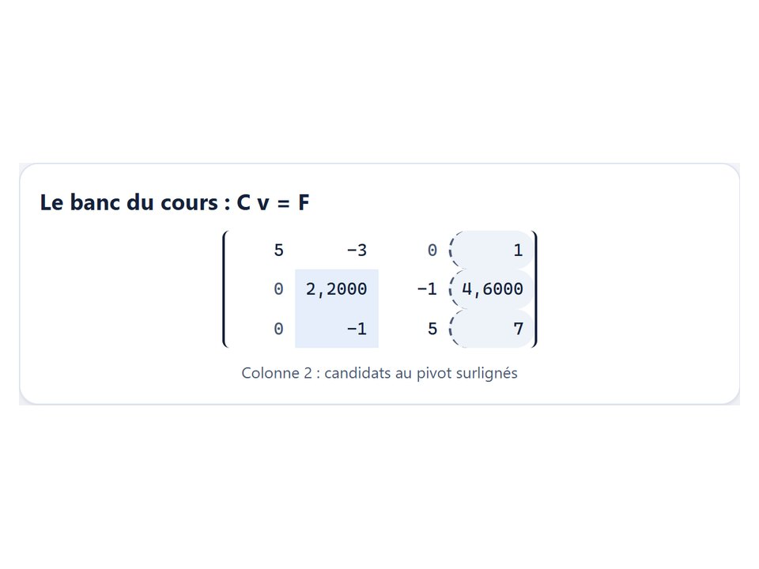</a><br/><b>2 · Gauss pas à pas</b><br/><sub>Pivot partiel, multiplicateurs, remontée</sub><br/><a href="https://janane-allah.github.io/jeux/tp1/#jeu-2"></a></td>
<td width="33%" valign="top" align="center"><a href="https://janane-allah.github.io/jeux/tp1/#jeu-3">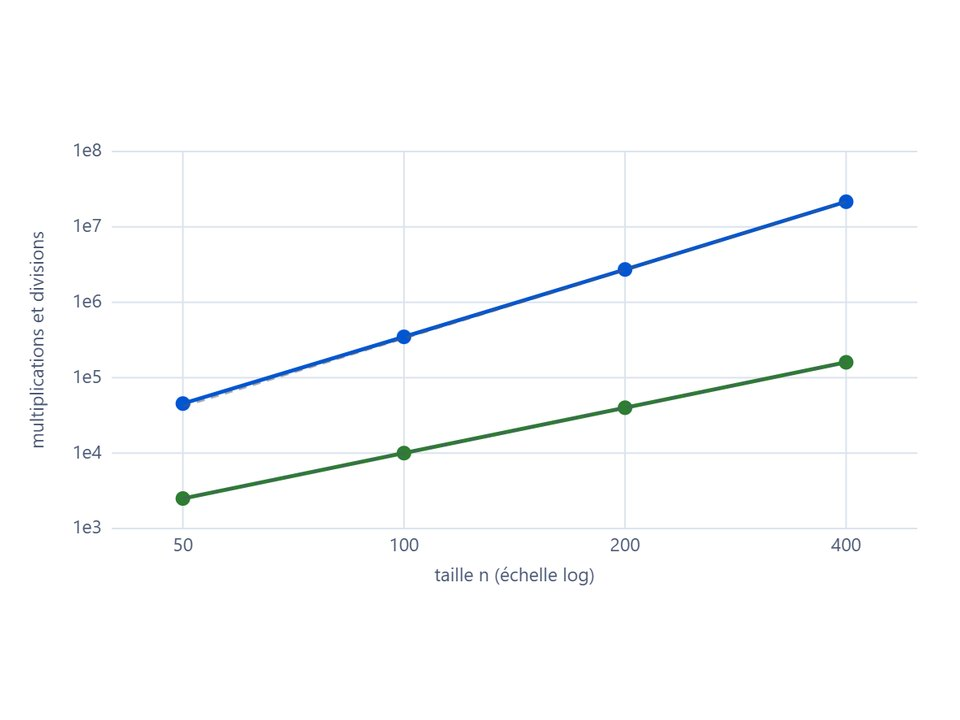</a><br/><b>3 · Le compteur d'opérations</b><br/><sub>n³/3 pour Gauss, n² par second membre</sub><br/><a href="https://janane-allah.github.io/jeux/tp1/#jeu-3"></a></td>
</tr>
<tr>
<td width="33%" valign="top" align="center"><a href="https://janane-allah.github.io/jeux/tp1/#jeu-4">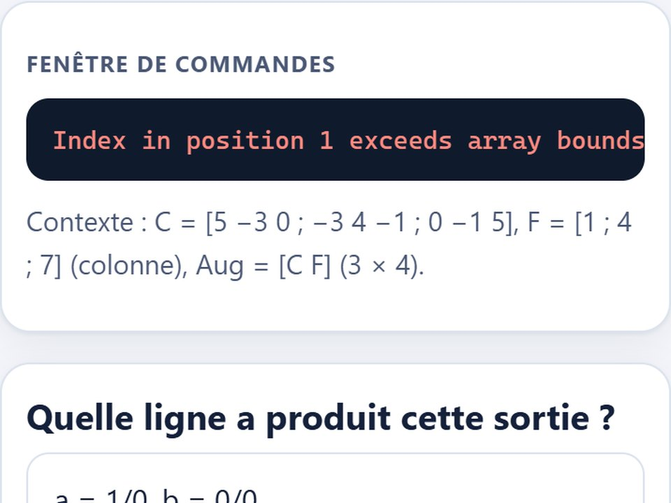</a><br/><b>4 · Les messages d'erreur</b><br/><sub>Huit vrais messages de MATLAB</sub><br/><a href="https://janane-allah.github.io/jeux/tp1/#jeu-4"></a></td>
<td width="33%" valign="top" align="center"><a href="https://janane-allah.github.io/jeux/tp1/#jeu-5">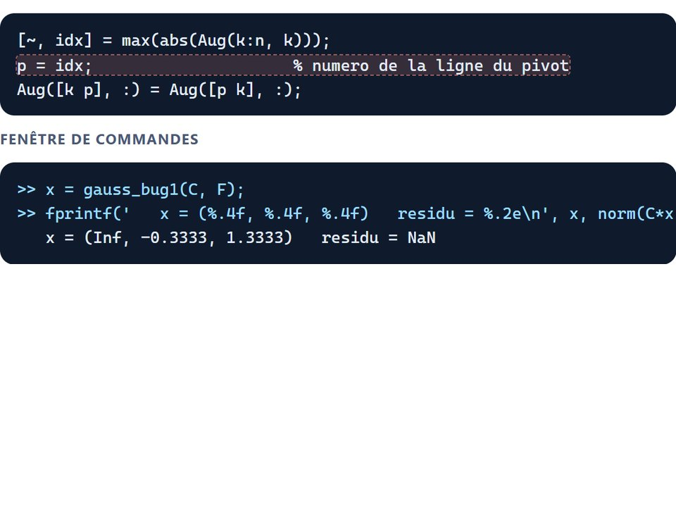</a><br/><b>5 · Détective du code</b><br/><sub>Les bugs silencieux et le résidu</sub><br/><a href="https://janane-allah.github.io/jeux/tp1/#jeu-5"></a></td>
<td width="33%" valign="top">🏆 <b>Comment jouer</b><br/><br/>💻📱 Sur ordinateur ou sur téléphone, sans installation ni compte.<br/><br/>⭐ Jusqu'à 3 étoiles par jeu ; la progression reste dans votre navigateur.<br/><br/>💡 Jouez <b>après</b> avoir lu l'énoncé et <b>avant</b> d'écrire votre code MATLAB.</td>
</tr>
</table>

### TP2 · Module 03 — la paroi du four (méthodes itératives)

<table>
<tr>
<td width="33%" valign="top" align="center"><a href="https://janane-allah.github.io/jeux/tp2/#jeu-1">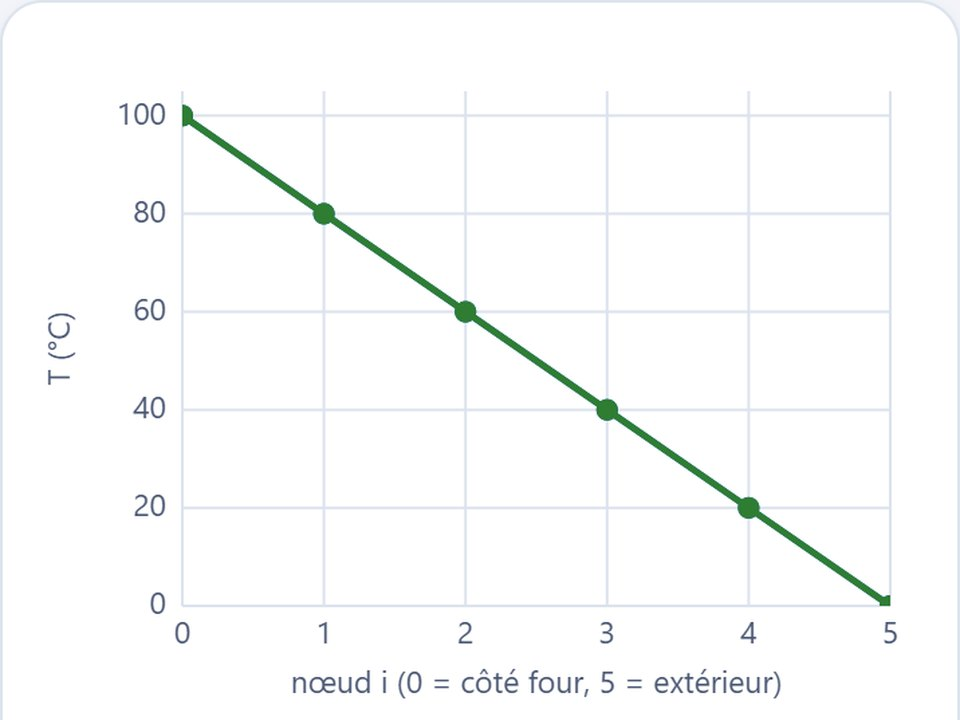</a><br/><b>1 · Jacobi contre Gauss-Seidel</b><br/><sub>La course, une seule ligne d'écart, ρ_GS = ρ_J²</sub><br/><a href="https://janane-allah.github.io/jeux/tp2/#jeu-1"></a></td>
<td width="33%" valign="top" align="center"><a href="https://janane-allah.github.io/jeux/tp2/#jeu-2">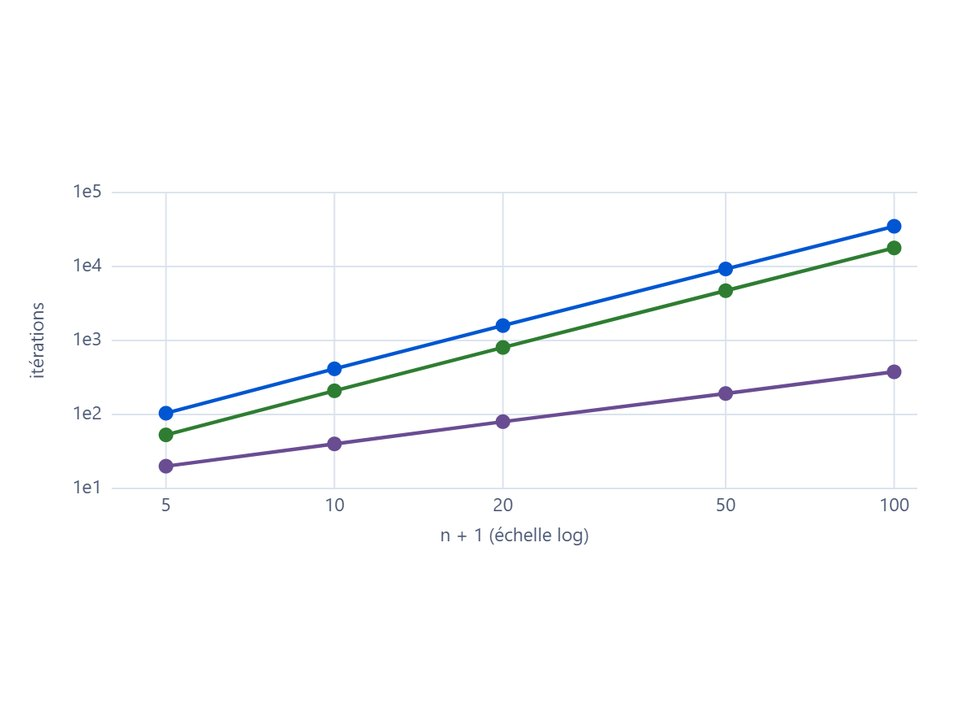</a><br/><b>2 · La paroi s'affine</b><br/><sub>Le nombre d'itérations quand n augmente</sub><br/><a href="https://janane-allah.github.io/jeux/tp2/#jeu-2"></a></td>
<td width="33%" valign="top" align="center"><a href="https://janane-allah.github.io/jeux/tp2/#jeu-3">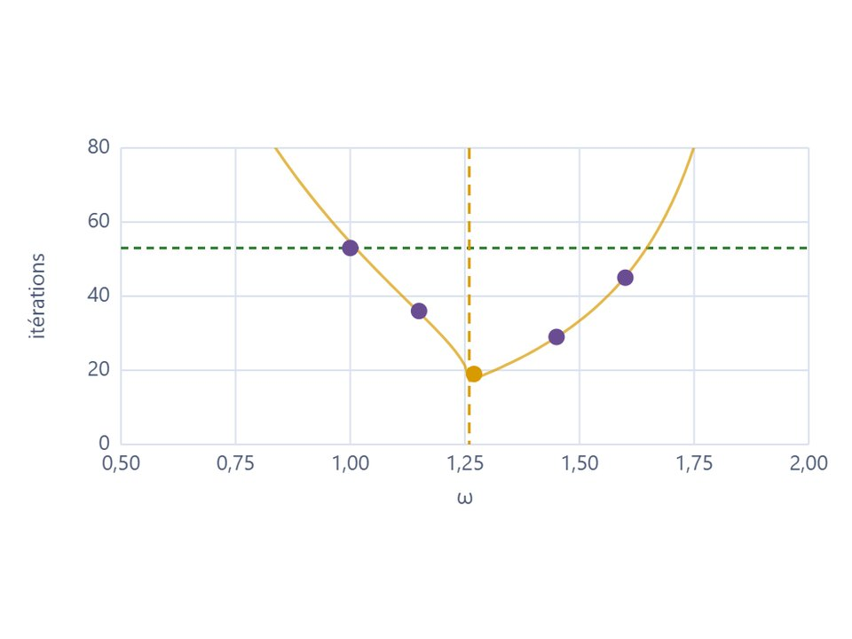</a><br/><b>3 · La chasse au ω*</b><br/><sub>SOR, formule de Young, courbe asymétrique</sub><br/><a href="https://janane-allah.github.io/jeux/tp2/#jeu-3"></a></td>
</tr>
<tr>
<td width="33%" valign="top" align="center"><a href="https://janane-allah.github.io/jeux/tp2/#jeu-4">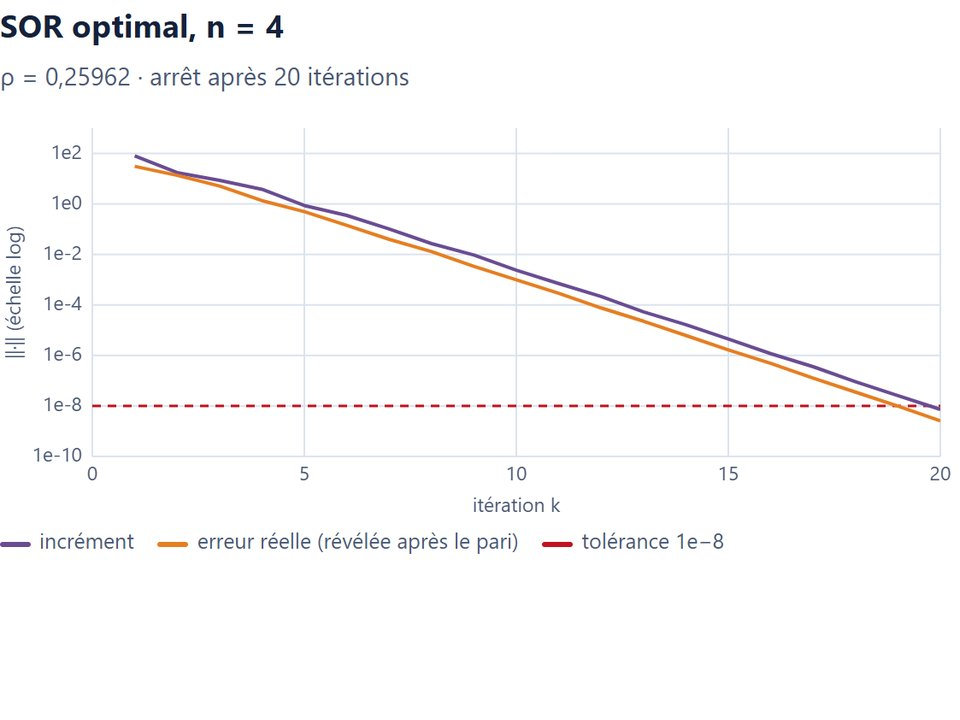</a><br/><b>4 · Incrément ou erreur ?</b><br/><sub>Le critère d'arrêt et le facteur ρ/(1 − ρ)</sub><br/><a href="https://janane-allah.github.io/jeux/tp2/#jeu-4"></a></td>
<td width="33%" valign="top" align="center"><a href="https://janane-allah.github.io/jeux/tp2/#jeu-5">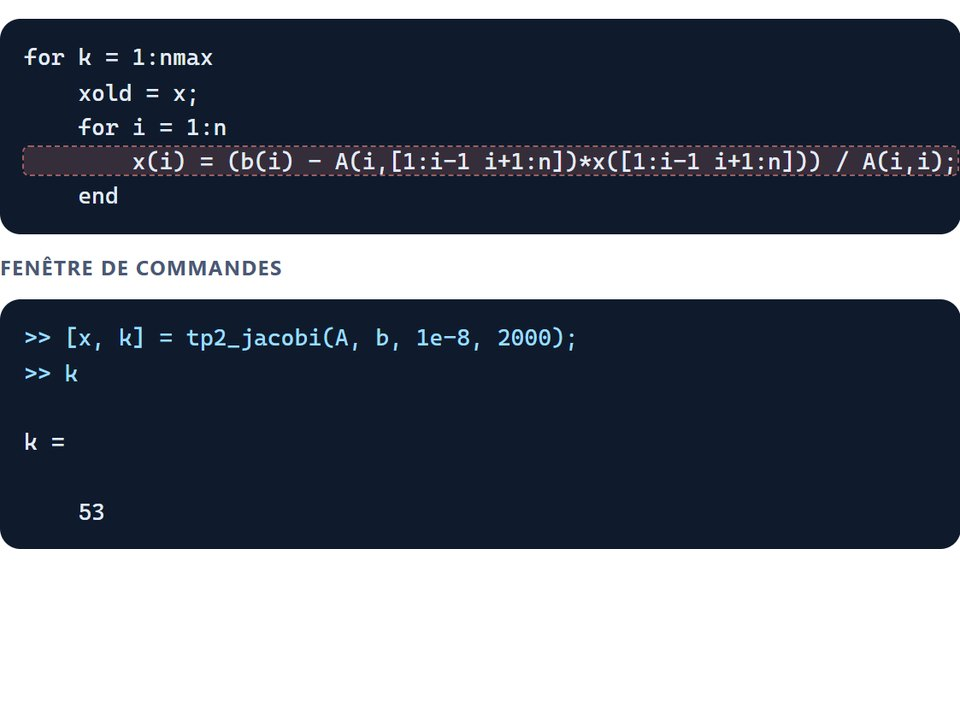</a><br/><b>5 · Détective du code</b><br/><sub>Reconnaître un bug à sa sortie console</sub><br/><a href="https://janane-allah.github.io/jeux/tp2/#jeu-5"></a></td>
<td width="33%" valign="top">🏆 <b>Comment jouer</b><br/><br/>💻📱 Sur ordinateur ou sur téléphone, sans installation ni compte.<br/><br/>⭐ Jusqu'à 3 étoiles par jeu ; la progression reste dans votre navigateur.<br/><br/>💡 Jouez <b>après</b> avoir lu l'énoncé et <b>avant</b> d'écrire votre code MATLAB.</td>
</tr>
</table>

### TP3 · Module 04 — le système de pompage (Newton)

<table>
<tr>
<td width="33%" valign="top" align="center"><a href="https://janane-allah.github.io/jeux/tp3/#jeu-1">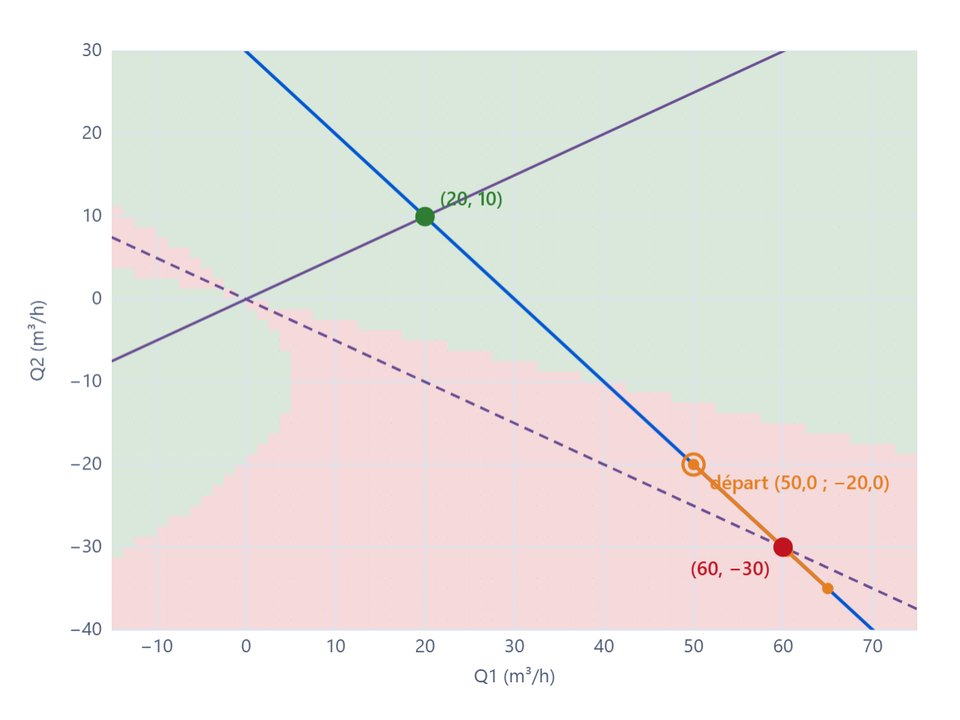</a><br/><b>1 · Newton dans le plan des débits</b><br/><sub>Convergence quadratique, deux racines, bassins</sub><br/><a href="https://janane-allah.github.io/jeux/tp3/#jeu-1"></a></td>
<td width="33%" valign="top" align="center"><a href="https://janane-allah.github.io/jeux/tp3/#jeu-2">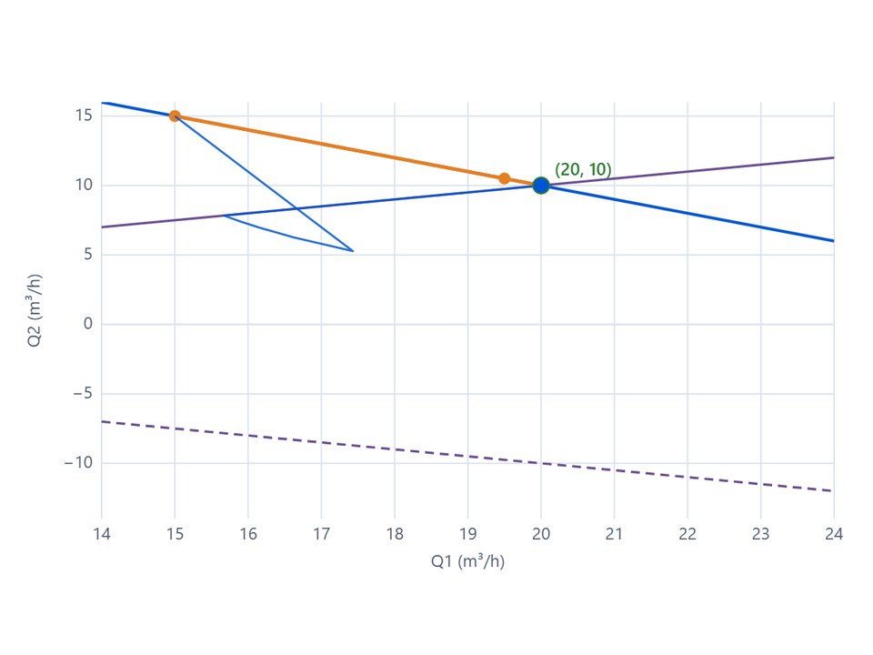</a><br/><b>2 · Newton contre le gradient</b><br/><sub>5 itérations contre 295 923</sub><br/><a href="https://janane-allah.github.io/jeux/tp3/#jeu-2"></a></td>
<td width="33%" valign="top" align="center"><a href="https://janane-allah.github.io/jeux/tp3/#jeu-3">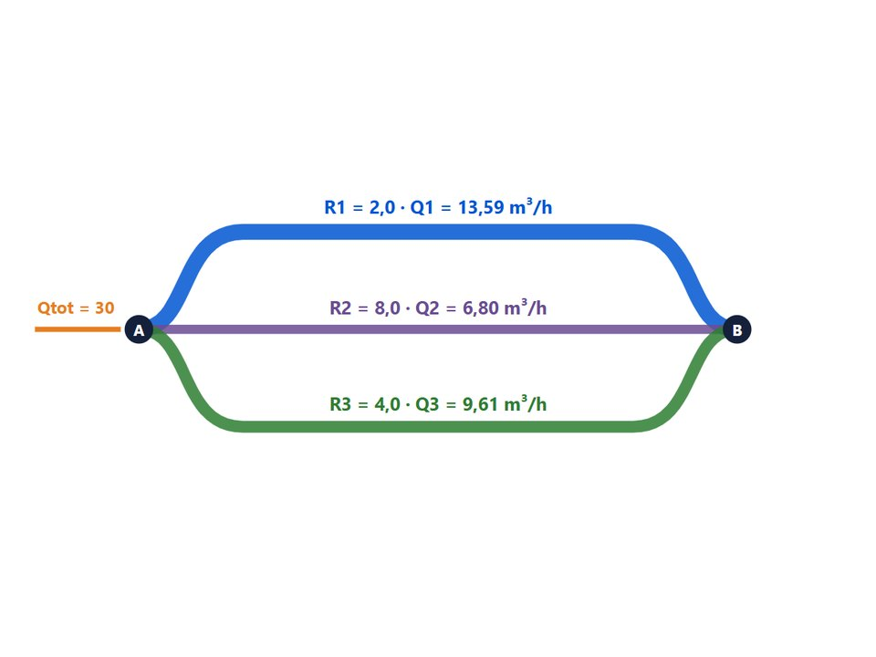</a><br/><b>3 · Trois conduites</b><br/><sub>Système 3 × 3, débits en 1/√R</sub><br/><a href="https://janane-allah.github.io/jeux/tp3/#jeu-3"></a></td>
</tr>
<tr>
<td width="33%" valign="top" align="center"><a href="https://janane-allah.github.io/jeux/tp3/#jeu-4">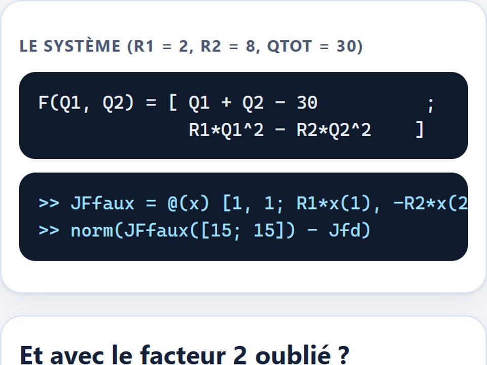</a><br/><b>4 · La jacobienne à la main</b><br/><sub>Dériver, vérifier par différences finies</sub><br/><a href="https://janane-allah.github.io/jeux/tp3/#jeu-4"></a></td>
<td width="33%" valign="top" align="center"><a href="https://janane-allah.github.io/jeux/tp3/#jeu-5">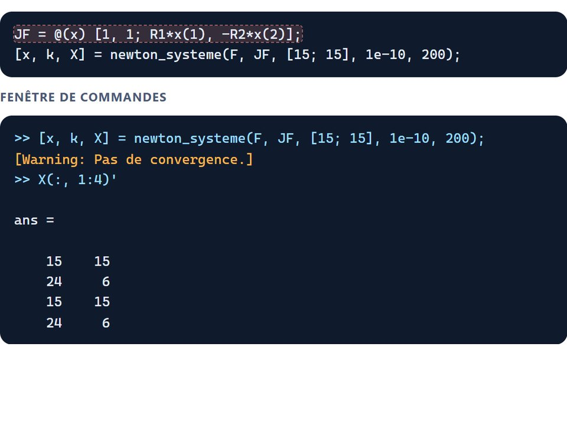</a><br/><b>5 · Détective du code</b><br/><sub>Signe, départ singulier, paramètre capturé</sub><br/><a href="https://janane-allah.github.io/jeux/tp3/#jeu-5"></a></td>
<td width="33%" valign="top">🏆 <b>Comment jouer</b><br/><br/>💻📱 Sur ordinateur ou sur téléphone, sans installation ni compte.<br/><br/>⭐ Jusqu'à 3 étoiles par jeu ; la progression reste dans votre navigateur.<br/><br/>💡 Jouez <b>après</b> avoir lu l'énoncé et <b>avant</b> d'écrire votre code MATLAB.</td>
</tr>
</table>

### TP4 · Module 11 — la paroi de four (EDO non linéaire)

<table>
<tr>
<td width="33%" valign="top" align="center"><a href="https://janane-allah.github.io/jeux/tp4/#jeu-1">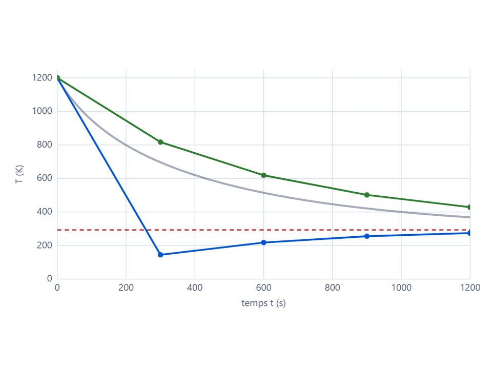</a><br/><b>1 · Le pas de trop</b><br/><sub>Euler explicite : précision, pas critique, implicite</sub><br/><a href="https://janane-allah.github.io/jeux/tp4/#jeu-1"></a></td>
<td width="33%" valign="top" align="center"><a href="https://janane-allah.github.io/jeux/tp4/#jeu-2">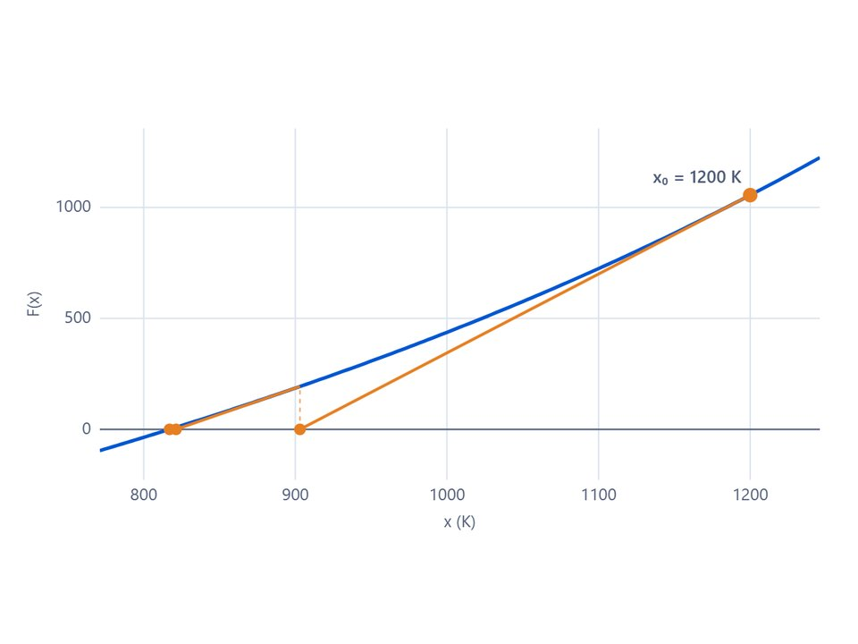</a><br/><b>2 · Newton, pas à pas</b><br/><sub>La boucle de Newton d'Euler implicite</sub><br/><a href="https://janane-allah.github.io/jeux/tp4/#jeu-2"></a></td>
<td width="33%" valign="top" align="center"><a href="https://janane-allah.github.io/jeux/tp4/#jeu-3">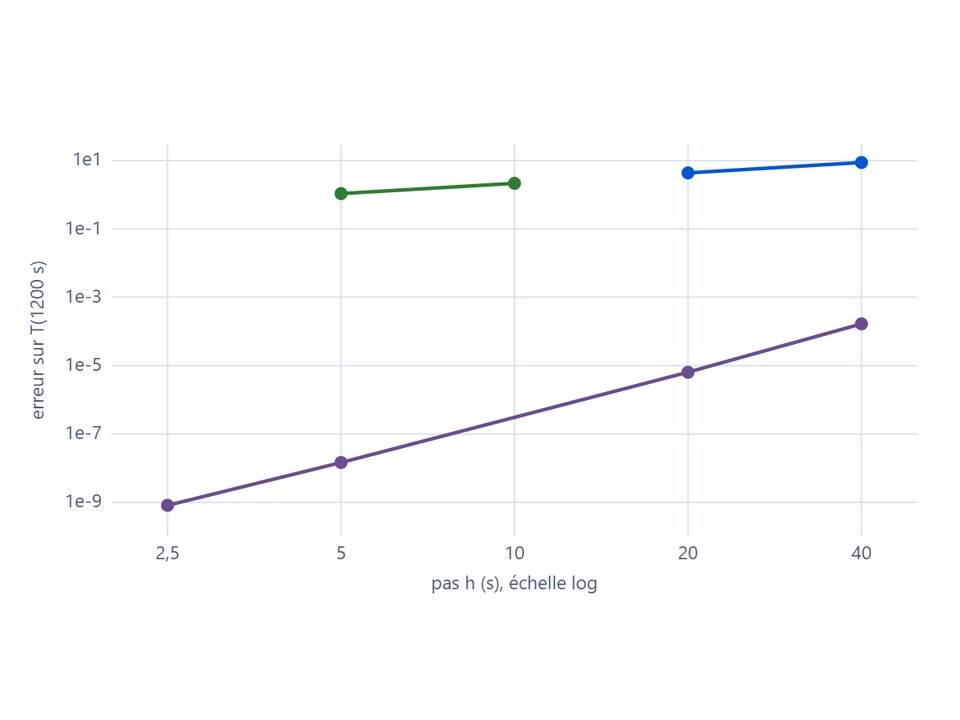</a><br/><b>3 · Le duel des schémas</b><br/><sub>Ordre de convergence et coût égal</sub><br/><a href="https://janane-allah.github.io/jeux/tp4/#jeu-3"></a></td>
</tr>
<tr>
<td width="33%" valign="top" align="center"><a href="https://janane-allah.github.io/jeux/tp4/#jeu-4">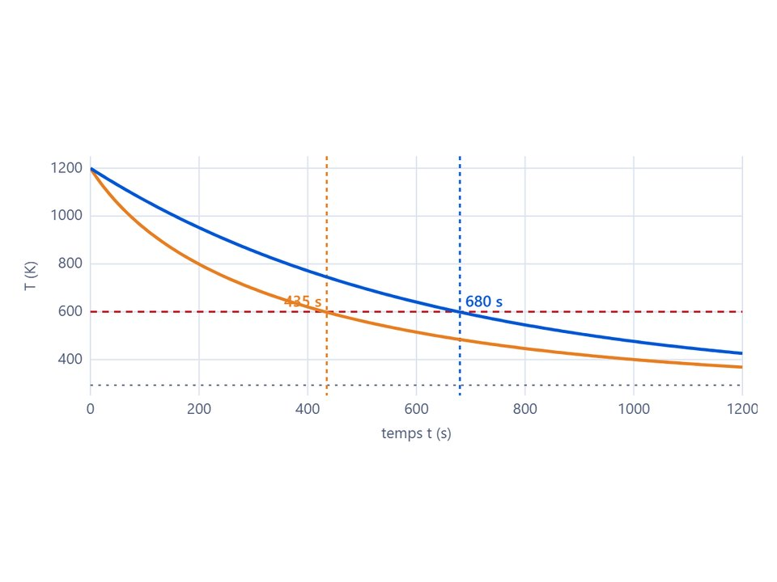</a><br/><b>4 · Convection contre rayonnement</b><br/><sub>Deux flux, un seul en T⁴</sub><br/><a href="https://janane-allah.github.io/jeux/tp4/#jeu-4"></a></td>
<td width="33%" valign="top" align="center"><a href="https://janane-allah.github.io/jeux/tp4/#jeu-5">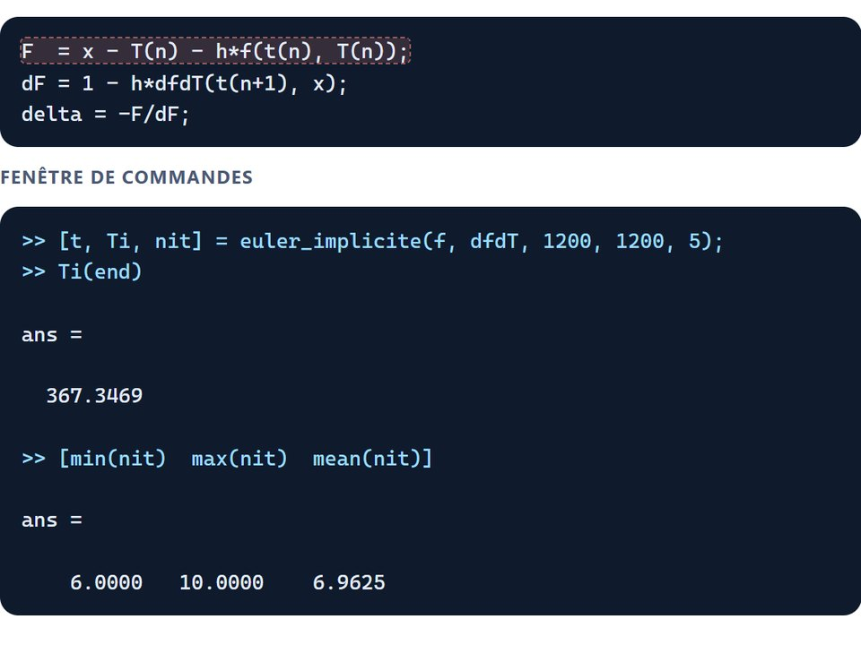</a><br/><b>5 · Détective du code</b><br/><sub>Reconnaître un bug à sa sortie console</sub><br/><a href="https://janane-allah.github.io/jeux/tp4/#jeu-5"></a></td>
<td width="33%" valign="top">🏆 <b>Comment jouer</b><br/><br/>💻📱 Sur ordinateur ou sur téléphone, sans installation ni compte.<br/><br/>⭐ Jusqu'à 3 étoiles par jeu ; la progression reste dans votre navigateur.<br/><br/>💡 Jouez <b>après</b> avoir lu l'énoncé et <b>avant</b> d'écrire votre code MATLAB.</td>
</tr>
</table>

### TP5 · Module 09 — la salle de sport (Poisson 2D)

<table>
<tr>
<td width="33%" valign="top" align="center"><a href="https://janane-allah.github.io/jeux/tp5/#jeu-1">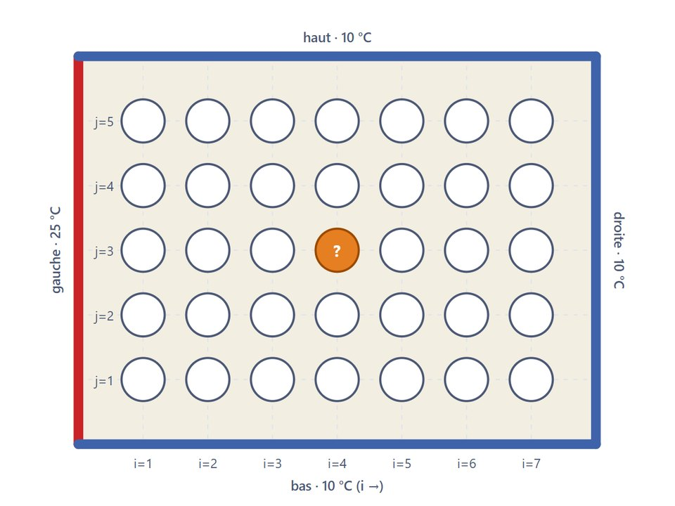</a><br/><b>1 · Numéro, s'il vous plaît !</b><br/><sub>La numérotation k = (j − 1)·nx + i</sub><br/><a href="https://janane-allah.github.io/jeux/tp5/#jeu-1"></a></td>
<td width="33%" valign="top" align="center"><a href="https://janane-allah.github.io/jeux/tp5/#jeu-2">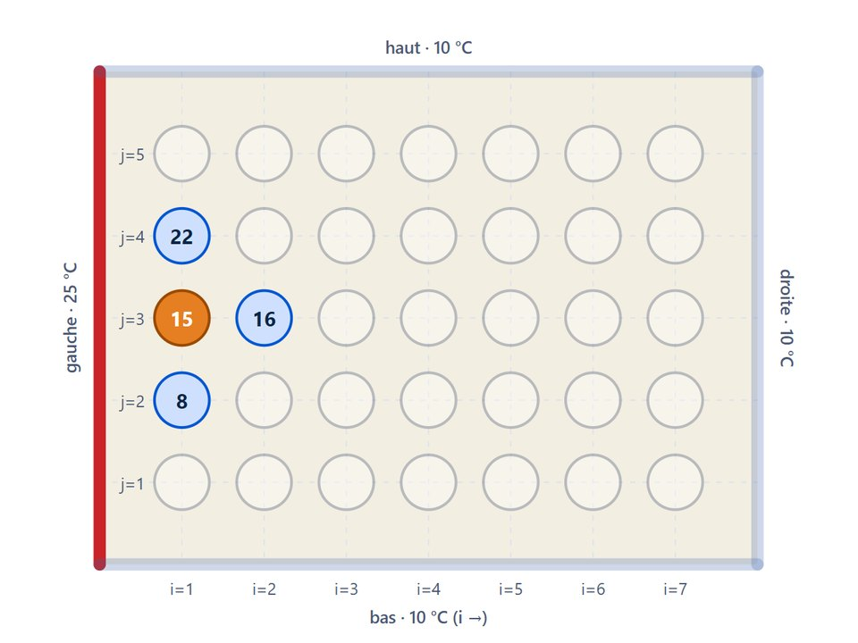</a><br/><b>2 · Le pochoir à 5 points</b><br/><sub>Assembler une ligne de A et de b</sub><br/><a href="https://janane-allah.github.io/jeux/tp5/#jeu-2"></a></td>
<td width="33%" valign="top" align="center"><a href="https://janane-allah.github.io/jeux/tp5/#jeu-3">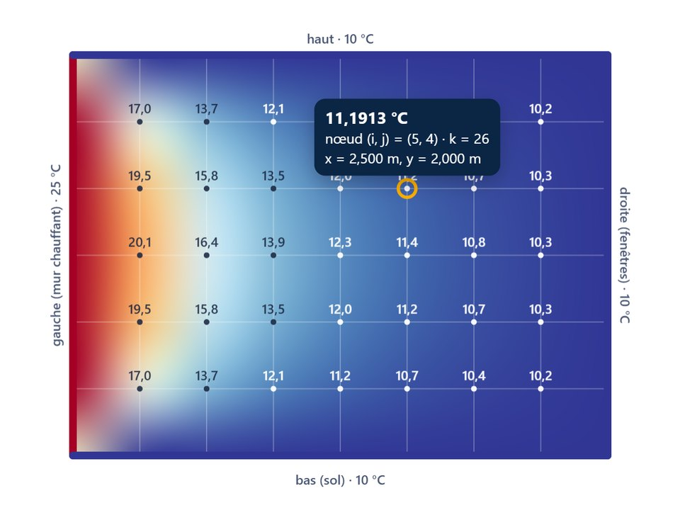</a><br/><b>3 · Thermostat de la salle</b><br/><sub>T = A \ b, principe du maximum, mur isolé</sub><br/><a href="https://janane-allah.github.io/jeux/tp5/#jeu-3"></a></td>
</tr>
<tr>
<td width="33%" valign="top" align="center"><a href="https://janane-allah.github.io/jeux/tp5/#jeu-4">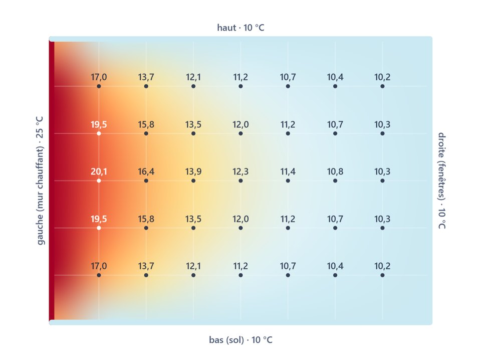</a><br/><b>4 · Course SOR</b><br/><sub>Battre Gauss-Seidel, trouver le ω optimal</sub><br/><a href="https://janane-allah.github.io/jeux/tp5/#jeu-4"></a></td>
<td width="33%" valign="top" align="center"><a href="https://janane-allah.github.io/jeux/tp5/#jeu-5">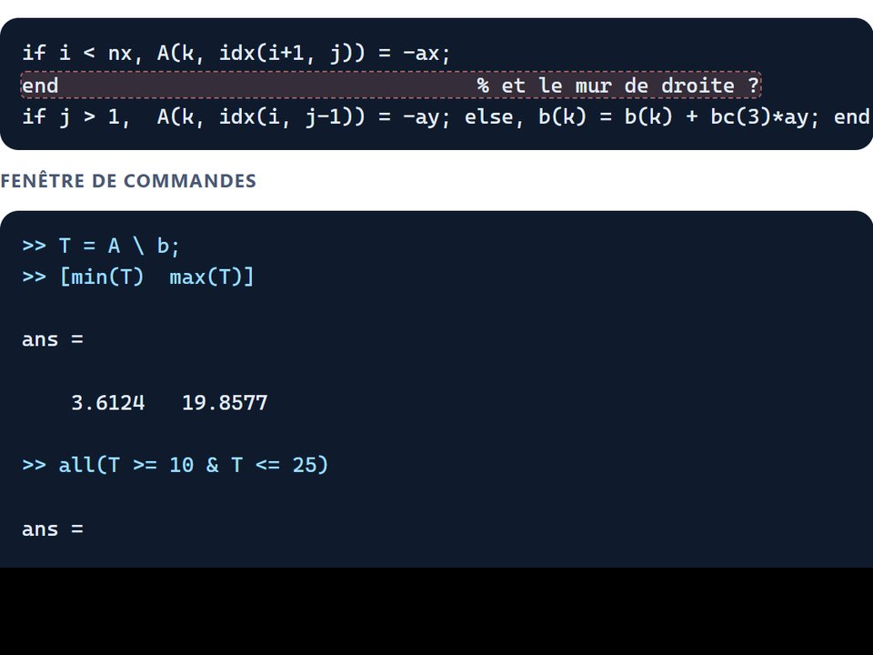</a><br/><b>5 · Détective du code</b><br/><sub>Reconnaître un bug à sa sortie console</sub><br/><a href="https://janane-allah.github.io/jeux/tp5/#jeu-5"></a></td>
<td width="33%" valign="top">🏆 <b>Comment jouer</b><br/><br/>💻📱 Sur ordinateur ou sur téléphone, sans installation ni compte.<br/><br/>⭐ Jusqu'à 3 étoiles par jeu ; la progression reste dans votre navigateur.<br/><br/>💡 Jouez <b>après</b> avoir lu l'énoncé et <b>avant</b> d'écrire votre code MATLAB.</td>
</tr>
</table>

### TP6 · Module 11 — l'attracteur de Lorenz (système d'EDO)

<table>
<tr>
<td width="33%" valign="top" align="center"><a href="https://janane-allah.github.io/jeux/tp6/#jeu-1">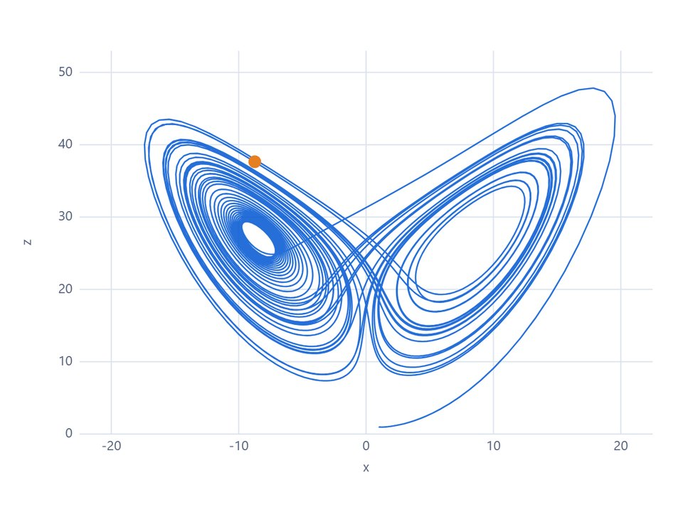</a><br/><b>1 · Le papillon de Lorenz</b><br/><sub>RK4 pour un système, centres, rôle de ρ</sub><br/><a href="https://janane-allah.github.io/jeux/tp6/#jeu-1"></a></td>
<td width="33%" valign="top" align="center"><a href="https://janane-allah.github.io/jeux/tp6/#jeu-2">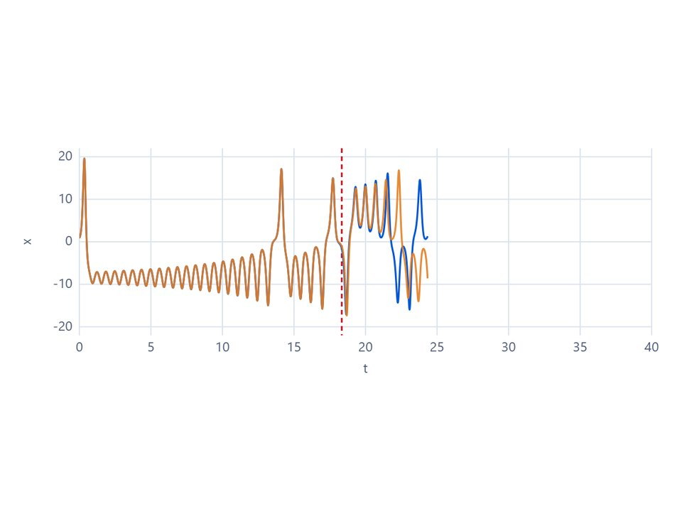</a><br/><b>2 · L'effet papillon</b><br/><sub>Sensibilité aux conditions initiales</sub><br/><a href="https://janane-allah.github.io/jeux/tp6/#jeu-2"></a></td>
<td width="33%" valign="top" align="center"><a href="https://janane-allah.github.io/jeux/tp6/#jeu-3">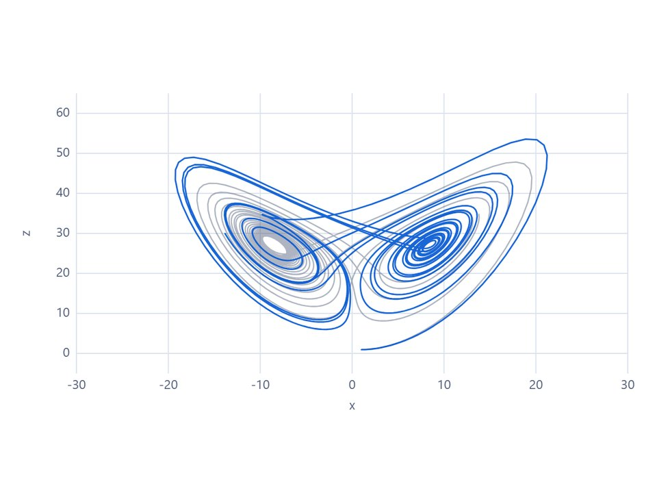</a><br/><b>3 · Crash test : Euler contre RK4</b><br/><sub>Pas de temps, explosion, coût égal</sub><br/><a href="https://janane-allah.github.io/jeux/tp6/#jeu-3"></a></td>
</tr>
<tr>
<td width="33%" valign="top" align="center"><a href="https://janane-allah.github.io/jeux/tp6/#jeu-4">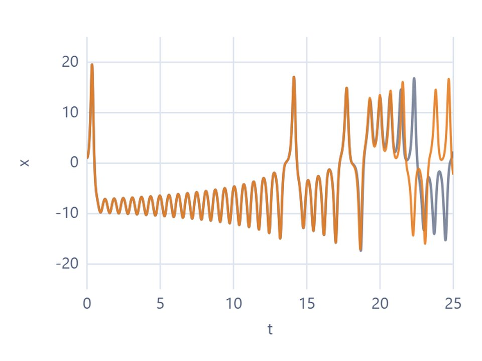</a><br/><b>4 · Instabilité, chaos ou erreur ?</b><br/><sub>Classer huit courbes calculées</sub><br/><a href="https://janane-allah.github.io/jeux/tp6/#jeu-4"></a></td>
<td width="33%" valign="top" align="center"><a href="https://janane-allah.github.io/jeux/tp6/#jeu-5">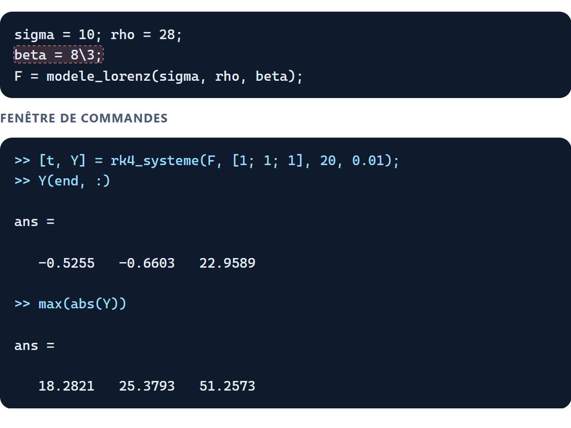</a><br/><b>5 · Détective du code</b><br/><sub>Reconnaître un bug à sa sortie console</sub><br/><a href="https://janane-allah.github.io/jeux/tp6/#jeu-5"></a></td>
<td width="33%" valign="top">🏆 <b>Comment jouer</b><br/><br/>💻📱 Sur ordinateur ou sur téléphone, sans installation ni compte.<br/><br/>⭐ Jusqu'à 3 étoiles par jeu ; la progression reste dans votre navigateur.<br/><br/>💡 Jouez <b>après</b> avoir lu l'énoncé et <b>avant</b> d'écrire votre code MATLAB.</td>
</tr>
</table>

---

<div align="center">

[](mailto:mohamedjanane147@gmail.com)
[](https://janane-allah.github.io)
[](../README.md)

<sub>Page générée par <code>tools/build_page.py</code> · Université Hassan II de Casablanca — FSTM</sub>

</div>
