

**Pr. Mohamed JANANE ALLAH**, PhD 
École Nationale Supérieure d'Arts et Métiers (ENSAM) — Casablanca

🎓 **Public :** Licence Professionnelle Universitaire *Ingénierie Mécanique et Productique Industrielle* (IMPI)

 

🆕 **Nouveau · 8 nov. 2026** — chapitres 4 « Circuits hydrauliques » (71 pages, 9 exercices corrigés) et 5 « Maintenance des installations » (90 pages, 7 exercices corrigés) en ligne, avec leur mémento : les cinq chapitres du module sont publiés.

[**Plan du module**](#-plan-du-module) · [**🧊 Simulations 3D**](#-simulations-3d) · [**Énigmes**](#-énigmes-de-terrain) · [**Mémento**](#-mémento-du-technicien) · [**Mini-projets**](#-mini-projets) · [**En images**](#-le-module-en-images) · [**Prérequis et évaluation**](#-prérequis-et-évaluation) · [**Contact**](#-contact)

---

## 🎯 Compétences visées par le module

À l'issue des cinq chapitres, vous saurez :

1. ✅ **comprendre les bases de l'hydraulique** ;
2. ✅ **connaître les composants** d'un circuit ;
3. ✅ **concevoir un circuit** de base ;
4. ✅ **découvrir la technologie** des systèmes hydrauliques ;
5. ✅ **assurer la maintenance** des installations.

---

## 🧠 Énigmes de terrain

Chaque chapitre s'ouvre sur quatre questions d'atelier. Cherchez la réponse, puis vérifiez-la dans la partie indiquée du chapitre.

| Ch. | L'énigme | La réponse est dans… |
|:-:|---|---|
| **01** | Pourquoi un flexible de pelle est-il chaud au toucher alors qu'il ne fait que transporter de l'huile ? | Partie 8 · pertes de charge |
| **01** | Pourquoi une pompe « siffle » quand l'huile est froide ou la crépine encrassée ? | Parties 4 et 5 · aspiration, viscosité |
| **01** | Comment un vérin de 10 cm de diamètre soulève-t-il l'équivalent de 20 tonnes ? | Partie 3 · pression × surface |
| **01** | Pourquoi la pédale de frein devient-elle « spongieuse » quand il y a de l'air dans le circuit ? | Partie 7 · compressibilité |
| **02** | Pourquoi une pompe est-elle un cercle avec un triangle plein… et un moteur le même cercle avec le triangle à l'envers ? | Partie 4 · conversion |
| **02** | Un distributeur 4/3 : comment savoir, en 30 secondes, où va l'huile dans chaque position ? | Partie 3 · distribution |
| **02** | Le limiteur de pression protège le circuit, pourtant il est dessiné « fermé ». Pourquoi ? | Partie 2 · régulation |
| **02** | Pourquoi la source est-elle toujours en bas à gauche et les vérins en haut ? | Partie 6 · lire un schéma |
| **03** | Pourquoi une pompe à pistons axiaux exige-t-elle une huile filtrée à 10–20 µm ? | Parties 3 et 5 |
| **03** | Pourquoi faut-il décharger un accumulateur avant de le démonter ? | Partie 4 |
| **03** | Pourquoi la tige d'un vérin peut-elle se tordre alors que la pression est normale ? | Partie 7 |
| **03** | Pourquoi un moteur hydraulique « avale-t-il » de l'air quand on coupe l'alimentation ? | Partie 6 |
| **04** | Pourquoi un circuit fermé exige-t-il une seconde pompe, plus petite, en plus de la pompe principale ? | Partie 2 · circuits fermés |
| **04** | Pourquoi une pompe peut-elle tenir 200 bar au repos sans chauffer l'huile ? | Partie 4 · maintien de pression |
| **04** | Comment descendre une charge de 2 tonnes sans qu'elle ne s'emballe ? | Partie 5 · commande de débit |
| **04** | Pourquoi un moteur de 30 kW peut-il entraîner une pompe capable de 73 kW hydrauliques ? | Partie 6 · régulation de puissance |
| **05** | Pourquoi une pompe devient-elle bruyante alors que la pression affichée n'a pas changé ? | Partie 5 · cavitation |
| **05** | Pourquoi réduire la pression de 25 % peut-il multiplier par 2,4 la durée de vie d'une pompe ? | Partie 3 · durée de vie |
| **05** | Pourquoi faut-il décharger l'installation avant de toucher à un accumulateur ? | Partie 2 · maintenance hebdomadaire |
| **05** | Pourquoi une huile laiteuse ou noire doit-elle alerter, même si la machine fonctionne ? | Partie 1 · maintenance journalière |

---

## 📚 Plan du module

🟦 chapitre en ligne · ⬜ à venir · 🟪 mini-projets

<table>
<tr><td width="33%" valign="top" align="center"><a href="hydraulique/Chapitre_01_Generalites_systemes_hydrauliques/1_Cours_chapitre_01.pdf">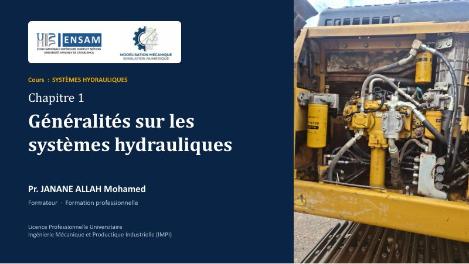</a> <b>01 · Généralités sur les systèmes hydrauliques</b> 71 pages · 8 parties · 5 TP <a href="hydraulique/Chapitre_01_Generalites_systemes_hydrauliques/1_Cours_chapitre_01.pdf">📄 Cours</a></td><td width="33%" valign="top" align="center"><a href="hydraulique/Chapitre_02_Schemas_hydrauliques_pneumatiques/1_Cours_chapitre_02.pdf">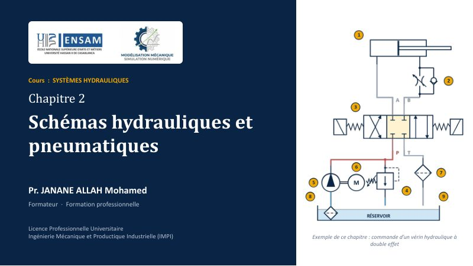</a> <b>02 · Schémas hydrauliques et pneumatiques</b> 73 pages · 6 parties · 5 TP <a href="hydraulique/Chapitre_02_Schemas_hydrauliques_pneumatiques/1_Cours_chapitre_02.pdf">📄 Cours</a> · <a href="https://drive.google.com/file/d/1kPl1OZvTW4uxDxojUoDT9yeFKKKwBmKj/view">▶ Vidéo</a></td><td width="33%" valign="top" align="center"><a href="hydraulique/Chapitre_03_Technologie_systemes_hydrauliques/1_Cours_chapitre_03.pdf">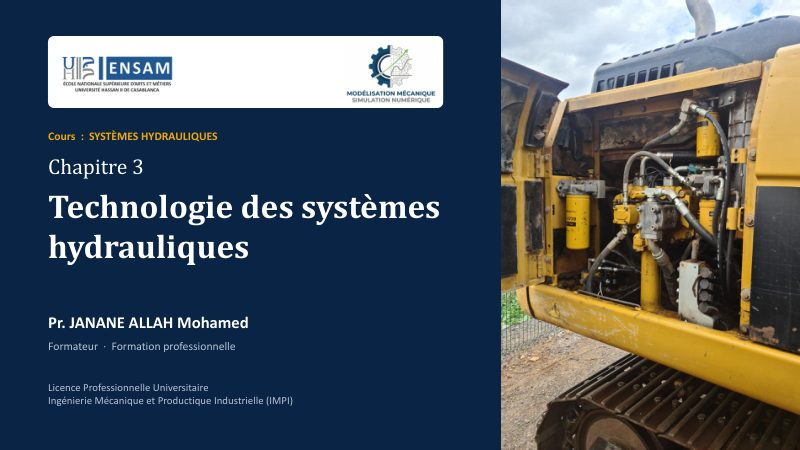</a> <b>03 · Technologie des systèmes hydrauliques</b> 115 pages · 9 parties · 5 TP <a href="hydraulique/Chapitre_03_Technologie_systemes_hydrauliques/1_Cours_chapitre_03.pdf">📄 Cours</a></td></tr>
<tr><td width="33%" valign="top" align="center"><a href="hydraulique/Chapitre_04_Circuits_hydrauliques/1_Cours_chapitre_04.pdf">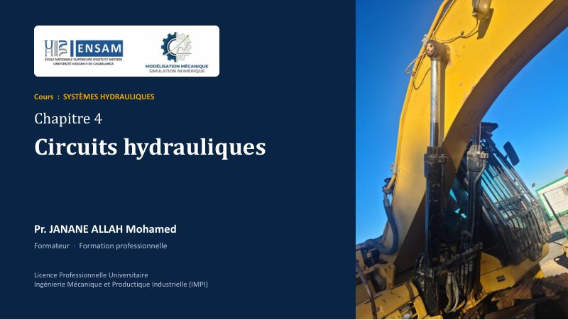</a> <b>04 · Circuits hydrauliques</b> 71 pages · 6 parties · 5 TP <a href="hydraulique/Chapitre_04_Circuits_hydrauliques/1_Cours_chapitre_04.pdf">📄 Cours</a></td><td width="33%" valign="top" align="center"><a href="hydraulique/Chapitre_05_Maintenance_installations/1_Cours_chapitre_05.pdf">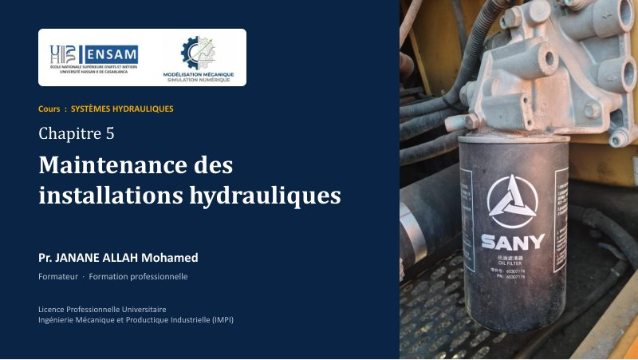</a> <b>05 · Maintenance des installations</b> 90 pages · 5 parties · 5 TP <a href="hydraulique/Chapitre_05_Maintenance_installations/1_Cours_chapitre_05.pdf">📄 Cours</a></td><td width="33%" valign="top" align="center"><a href="hydraulique/Mini_projet/Liste_28_sujets_mini_projets.pdf">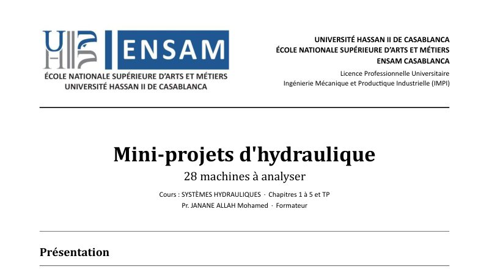</a> <b>🧩 Mini-projets</b> une machine réelle à analyser <a href="hydraulique/Mini_projet/Liste_28_sujets_mini_projets.pdf">📋 Les 28 sujets</a> · <a href="hydraulique/Mini_projet/Exemple_presentation_mini_projet_DOOSAN_Solar_225LC-V.pptx">📊 Un exemple</a></td></tr>
</table>

> 📘 Cliquez sur une couverture pour ouvrir le chapitre ; les cinq chapitres du module sont en ligne.

<i>Descriptif des chapitres publiés : parties, TP et points à retenir</i>

 

**01 — Généralités sur les systèmes hydrauliques** · 71 pages  
Hydraulique face au pneumatique et à l'électrique, chaîne d'énergie, grandeurs hydrauliques (pression, débit, force, puissance, rendement), Bernoulli, viscosité, régimes d'écoulement, compressibilité et pertes de charge. Durée indicative 6 à 8 h, applications chiffrées et TD corrigés intégrés, QCM d'auto-évaluation.

*Les huit parties du chapitre, une question chacune :*

1. **Hydraulique et pneumatique** — Pourquoi choisir l'huile plutôt que l'air ?
2. **Énergie mécanique et hydraulique** — Comment l'énergie circule-t-elle de la source à la charge ?
3. **Grandeurs hydrauliques** — Comment calculer pression, débit, force, puissance ?
4. **Fluides en mouvement** — Que devient l'énergie le long d'une conduite ?
5. **Viscosité** — Pourquoi une huile trop épaisse ou trop fluide change tout ?
6. **Régimes d'écoulement** — L'écoulement est-il laminaire ou turbulent ?
7. **Compressibilité et dilatation** — L'huile est-elle vraiment incompressible ?
8. **Pertes de charge** — Combien de pression perd-on en route ?

*Les TP associés, sur machine :*

- **TP 1 — Lire la machine** : repérer moteur, pompes, distributeur, vérins ; lire plaques et symboles
- **TP 2 — Pression et force** : lire un manomètre, relever la pression de tarage, calculer F = p · S
- **TP 3 — Débit et vitesse** : chronométrer une course de vérin et en déduire Q = S · v
- **TP 4 — Huile et température** : relever la température, lire la fiche d'huile, estimer le régime (Re)
- **TP 5 — Pertes et diagnostic** : mesurer Δp d'un filtre ou d'un flexible, lire le vacuomètre d'aspiration

*À retenir :*

> 1. La pompe crée le débit ; la pression naît de la résistance à l'écoulement.  
> 2. Vitesse ← débit (v = Q / S) · Force ← pression (F = p · S).  
> 3. Puissance = pression × débit ; l'énergie perdue devient de la chaleur.  
> 4. La viscosité dépend de la température : elle gouverne le régime, les pertes et le rendement.  
> 5. L'huile est quasi incompressible, pas totalement : air, dilatation et pertes de charge se calculent.  

**02 — Schémas hydrauliques et pneumatiques** · 73 pages  
Symboles normalisés (ISO 1219) des pompes, vérins, distributeurs, clapets et limiteurs ; lecture d'un distributeur et chemin du fluide ; régulation de pression et de débit ; règles de représentation et de repérage ; construction d'un circuit simple à partir d'un cahier des charges. Exemple fil rouge : commande d'un vérin hydraulique à double effet. Durée indicative 5 à 7 h, exercices corrigés, QCM d'auto-évaluation.

*Les six parties du chapitre, une question chacune :*

1. **Le langage du schéma** — Comment dessine-t-on des lignes, un réservoir, une source ?
2. **Régulation et protection** — Comment limiter la pression et régler le débit ?
3. **Distribution de l'énergie** — Comment aiguiller le fluide vers le bon actionneur ?
4. **Conversion de l'énergie** — Comment représenter pompes, moteurs et vérins ?
5. **Mesure et appareils complémentaires** — Comment voir ce qui se passe dans le circuit ?
6. **Lire et dessiner un schéma complet** — Comment lire, puis construire un circuit ?

*Les TP associés, sur machine :*

- **TP 1 — Lire la machine** : retrouver sur le schéma constructeur les symboles et leurs repères
- **TP 2 — Identifier les composants** : associer chaque symbole à un composant du banc : plaques, orifices
- **TP 3 — Câbler un circuit** : réaliser la commande d'un vérin double effet et vérifier les 3 positions
- **TP 4 — Régler et mesurer** : tarer le limiteur de pression, régler la vitesse, lire les manomètres
- **TP 5 — Dessiner et simuler** : dessiner le schéma d'une application et le valider, par simulation si possible

*À retenir :*

> 1. Un symbole représente une fonction, jamais la forme du composant.  
> 2. Un distributeur se lit case par case : orifices, positions, commande, repos.  
> 3. Le limiteur de pression protège (fermé), le réducteur règle l'aval (ouvert), le limiteur de débit règle la vitesse.  
> 4. Triangle plein : hydraulique, creux : pneumatique ; le sens du triangle distingue pompe et moteur.  
> 5. On dessine le circuit au repos : source en bas à gauche, actionneurs en haut.  

**03 — Technologie des systèmes hydrauliques** · 115 pages  
Les composants d'une installation, famille par famille : centrale, réservoirs, filtres, accumulateurs, pompes, moteurs, vérins, distributeurs, protection et régulation. Calculs de cylindrée, débit, couple et rendements, volume d'un accumulateur, effort et flambage d'un vérin, dimensionnement d'une centrale ; diagnostic des symptômes types (cavitation, colmatage, usure interne). Durée indicative 12 à 16 h hors TP, 9 exercices corrigés, fiches de formules, QCM d'auto-évaluation.

*Les neuf parties du chapitre, une question chacune :*

1. **Centrale hydraulique** — Comment est organisé le groupe de puissance ?
2. **Réservoirs** — Quel volume, quelles règles de conception ?
3. **Filtres** — Où placer le filtre et avec quelle finesse ?
4. **Accumulateurs** — Comment stocker l'énergie et l'amortir ?
5. **Pompes** — Quel type, quelle cylindrée, quel rendement ?
6. **Moteurs hydrauliques** — Quel couple, quelle vitesse ?
7. **Vérins** — Quel effort, quelle tige, quelle course ?
8. **Distributeurs** — Quelle taille, quelle commande ?
9. **Protection et régulation** — Comment limiter la pression et le débit ?

*Les TP associés, sur machine :*

- **TP 1 — Identifier** : nommer les composants d'une centrale ou d'une machine ; relever les plaques
- **TP 2 — Mesurer une pompe** : relever Q, p, N et C ; calculer ηv, ηhm et ηg
- **TP 3 — Accumulateur et filtre** : lire la précharge (hors pression), l'indicateur de colmatage, l'état du filtre
- **TP 4 — Vérin et moteur** : chronométrer une course, calculer F, v et le débit ; repérer le gavage
- **TP 5 — Distributeur et limiteur** : identifier la commande, câbler, tarer le limiteur et mesurer Δp

*À retenir :*

> 1. La propreté de l'huile protège tout : filtre au retour, crépine à l'aspiration, β élevé, code ISO 4406 suivi.  
> 2. La pompe crée le débit (Cyl · N · ηv) ; le moteur et le vérin le transforment en vitesse, couple et effort.  
> 3. Tout rendement < 1 : la différence devient chaleur, à évacuer par le réservoir ou un échangeur.  
> 4. Un accumulateur stocke l'énergie dans l'azote : précharge ≈ 0,9 p₁, décharger avant d'intervenir.  
> 5. Un vérin se dimensionne deux fois : en pression (alésage) et au flambage (tige).  

**04 — Circuits hydrauliques** · 71 pages  
Les six familles de circuits : principe et lecture d'un schéma, circuits fermés (transmission hydrostatique, gavage, valve d'échange), circuits ouverts (série, parallèle, effet différentiel), maintien de pression (accumulateur et conjoncteur-disjoncteur, pompe autorégulatrice), commande de débit sous charge motrice et régulation de puissance (courbe à puissance constante). Calculs de débits, vitesses, couples, puissances et volume d'accumulateur ; symptômes types (échauffement à vide, patinage, chute de charge, perte de gavage). Durée indicative 8 à 10 h hors TP, 9 exercices corrigés, fiche de formules, QCM d'auto-évaluation.

*Les six parties du chapitre, une question chacune :*

1. **Principe d'un circuit** — Quels blocs, dans quel ordre, et comment lit-on un schéma ?
2. **Circuits fermés** — Comment transmettre une puissance en boucle, dans les deux sens ?
3. **Circuits ouverts** — Comment manœuvrer vite, avec un ou plusieurs récepteurs ?
4. **Maintien de pression** — Comment garder la pression en attente sans gaspiller ?
5. **Commande de débit** — Comment régler une vitesse quand la charge est motrice ?
6. **Régulation de puissance** — Comment ne jamais dépasser la puissance disponible ?

*Les TP associés, sur machine :*

- **TP 1 — Lire et câbler** : relever le schéma d'un banc, repérer pression et retour, câbler un circuit simple
- **TP 2 — Transmission hydrostatique** : mesurer la pression de gavage, Δp entre A et B, la vitesse du moteur ; inverser le sens
- **TP 3 — Circuit ouvert à vérin** : chronométrer une course, calculer v et le débit, régler le limiteur, lire l'échauffement
- **TP 4 — Accumulateur** : relever P₁ et P₂ du conjoncteur-disjoncteur, le temps de charge et de décharge
- **TP 5 — Courbe p–Q** : tracer la caractéristique d'une pompe à régulation, repérer le tarage et la puissance limite

*À retenir :*

> 1. Un circuit est une chaîne d'énergie (source, distribution, récepteur) doublée d'une boucle d'information.  
> 2. Fermé : le retour va à la pompe, il faut du gavage et un petit réservoir. Ouvert : la pompe aspire au réservoir, c'est la rapidité de manœuvre.  
> 3. Maintien de pression : l'énergie est en réserve (accumulateur, entre P₁ et P₂) ou la pompe réduit son débit au tarage.  
> 4. Commande de débit : la vitesse dépend du débit de la pompe ; le limiteur de vitesse retient une charge motrice.  
> 5. Régulation de puissance : la cylindrée baisse quand la pression monte, pour que p · q reste sous P₀.  

**05 — Maintenance des installations** · 90 pages  
Une maintenance préventive planifiée : les huit vérifications journalières et les sept hebdomadaires, avec leurs critères (niveau, aspect et température de l'huile, filtres, pressions, fuites, accumulateurs, propreté ISO 4406), consignation et fiche d'historique ; durée de vie d'une pompe selon la vitesse, la pression (L₁₀ = (C/P)³), le fluide et l'alignement ; diagnostic des pannes de pompes, de l'aspect de la pièce à la cause ; cavitation, aération et budget de pression à l'aspiration. Durée indicative 6 à 8 h hors TP, 7 exercices corrigés, fiche de formules, QCM d'auto-évaluation et bilan du module.

*Les cinq parties du chapitre, une question chacune :*

1. **Maintenance journalière** — Quels huit points regarder chaque jour, et avec quels critères ?
2. **Maintenance hebdomadaire** — Quels sept points demandent un arrêt et une vraie inspection ?
3. **Durée de vie d'une pompe** — De quoi dépend-elle, et de combien chaque facteur la réduit-il ?
4. **Diagnostic des pannes** — Comment remonter de l'aspect d'une pièce à la cause du défaut ?
5. **Cavitation** — Pourquoi se produit-elle, comment l'entend-on, comment l'éviter ?

*Les TP associés, sur machine :*

- **TP 1 — Ronde quotidienne** : parcourir une machine avec la checklist des huit points et remplir la fiche d'historique
- **TP 2 — Propreté de l'huile** : prélever un échantillon, lire l'indicateur de colmatage et classer le fluide selon ISO 4406
- **TP 3 — Précharge d'un accumulateur** : consigner, décharger puis mesurer la précharge avec le kit de gonflage
- **TP 4 — Rendement d'une pompe** : mesurer Q et p, calculer ηv et le comparer à la valeur neuve
- **TP 5 — Aspiration et cavitation** : lire la dépression à l'aspiration, comparer crépine propre et colmatée

*À retenir :*

> 1. Huit points chaque jour, sept chaque semaine, avec un critère et une trace dans l'historique : sans critère, pas de décision.  
> 2. Consigner avant d'intervenir, décharger l'accumulateur, ne jamais chercher une fuite à la main.  
> 3. La pression est le premier facteur de durée de vie : × 1,5 de pression, ÷ 3,4 de durée ; × 1,33 de vitesse, − 25 %.  
> 4. Un défaut de pompe a une cause : filtration, cavitation, température, pression ou alignement ; on corrige la cause, pas seulement la pièce.  
> 5. La cavitation se joue à l'aspiration : niveau, crépine, tube, viscosité ; son signe est le bruit.  

---

## 🧊 Simulations 3D

Cinq bancs virtuels pour manipuler les composants du chapitre 3 avant le TP : on fait tourner les pièces **en coupe**, on déplace le tiroir, on met les vérins sous pression, on règle les pompes, on gonfle l'accumulateur et on compte les particules qu'arrête un filtre. Chaque banc propose des missions (jusqu'à 3 étoiles) ; les valeurs affichées viennent des formules du cours.

<table>
<tr>
<td width="50%" valign="top" align="center"><a href="https://janane-allah.github.io/simulations/hydraulique/#jeu-1">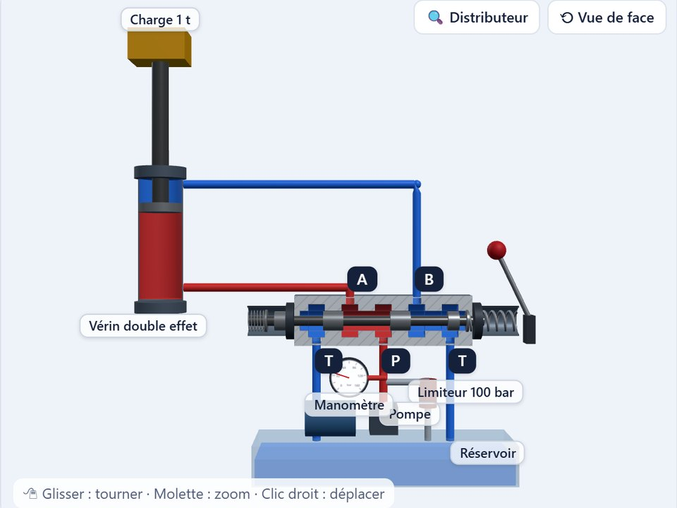</a> <b>Les distributeurs</b> · chapitre 3, partie 8 Le tiroir en coupe relié à un vérin chargé : déplacez-le au levier, le symbole ISO suit.  2/2, 3/2, 4/2 et les quatre centres du 4/3 · tenir une charge, décharger la pompe · lire la case active  </td>
<td width="50%" valign="top" align="center"><a href="https://janane-allah.github.io/simulations/hydraulique/#jeu-2">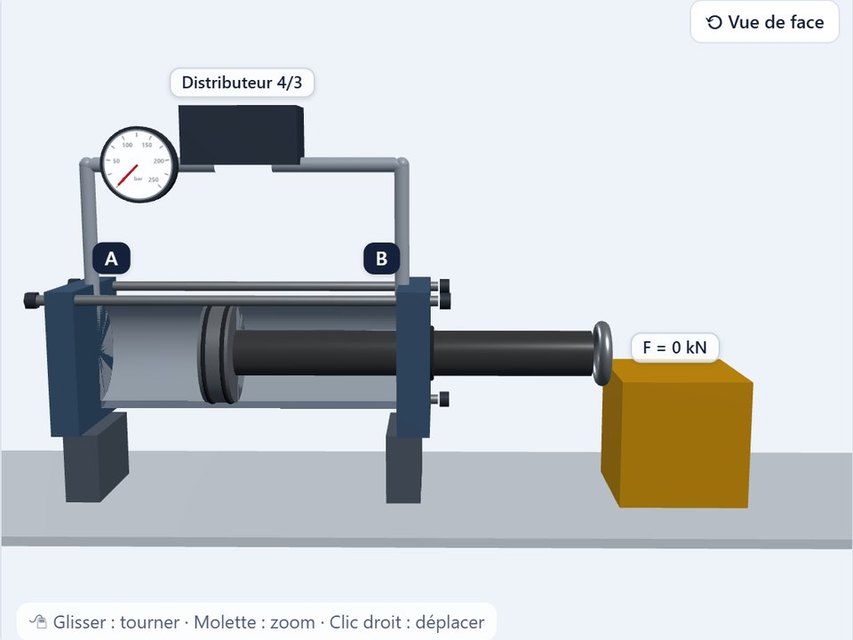</a> <b>Les vérins</b> · chapitre 3, partie 7 Simple effet, double effet, double tige, télescopique et rotatif, sous pression et chronométrés.  nommer les pièces en 3D · F = η p S, Vs = Q/S, Ve = Q/S' · l'exercice 7 : pousser 100 kN  </td>
</tr>
<tr>
<td width="50%" valign="top" align="center"><a href="https://janane-allah.github.io/simulations/hydraulique/#jeu-3">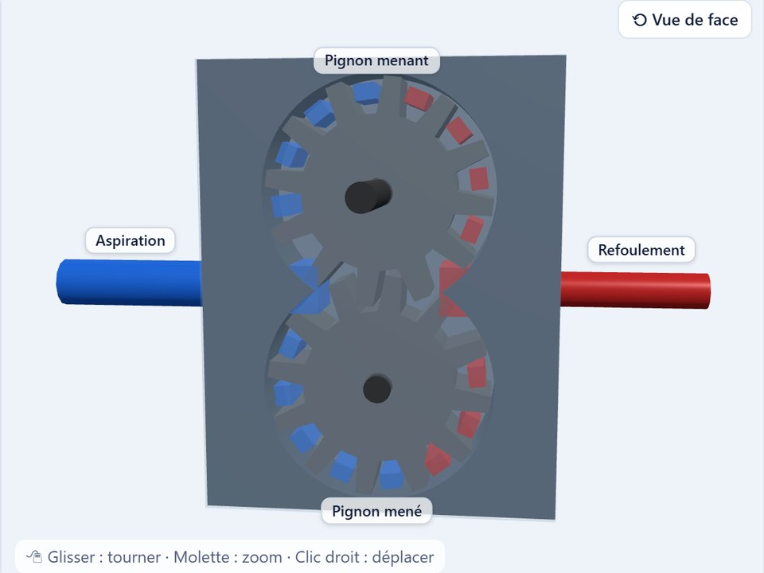</a> <b>Les pompes</b> · chapitre 3, partie 5 Engrenages, palettes et pistons axiaux en mouvement, sur un banc d'essai.  le chemin de l'huile · cylindrée, fuites et ηv · exercices 4 et 5 : bilan de puissance  </td>
<td width="50%" valign="top" align="center"><a href="https://janane-allah.github.io/simulations/hydraulique/#jeu-4">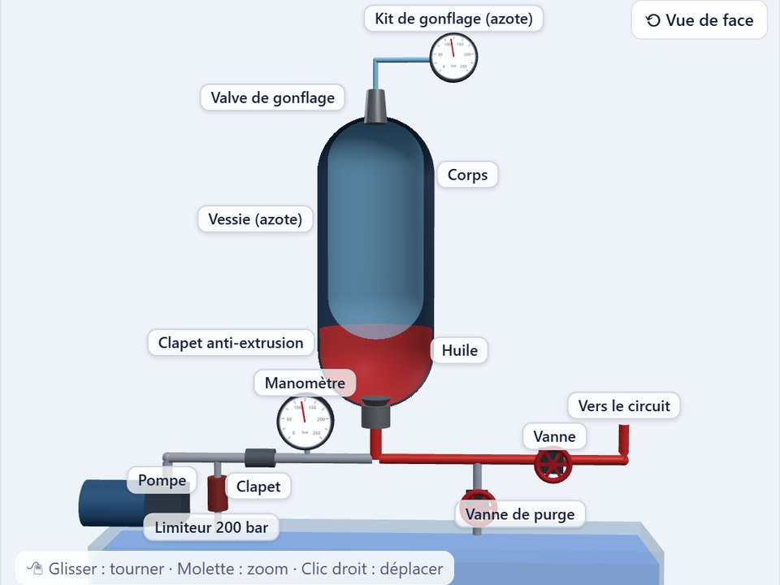</a> <b>L'accumulateur</b> · chapitre 3, partie 4 Vessie, piston ou membrane : précharge d'azote, remplissage, restitution.  p₀ = 0,9 p₁ · isotherme ou adiabatique (exercice 3) · les règles de sécurité  </td>
</tr>
<tr>
<td width="50%" valign="top" align="center"><a href="https://janane-allah.github.io/simulations/hydraulique/#jeu-5">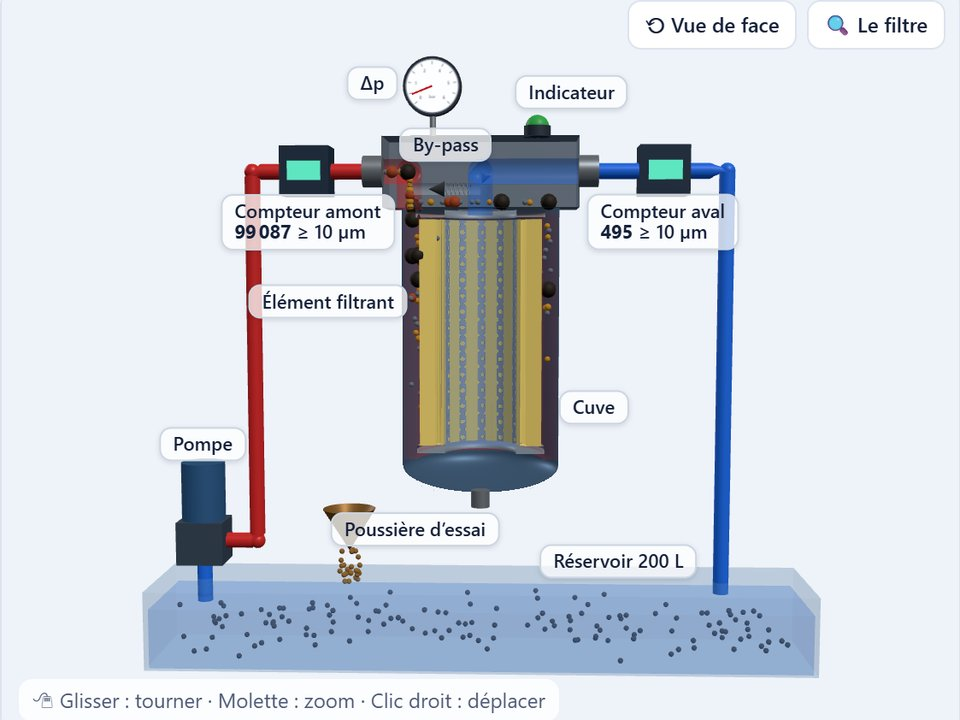</a> <b>Les filtres</b> · chapitre 3, partie 3 Un filtre en coupe entre deux compteurs de particules : rapport β, colmatage et by-pass.  β = N amont / N aval, η = 1 − 1/β · colmatage, indicateur, by-pass · exercice 2 et les quatre emplacements  </td>
</tr>
</table>

💻📱 Sur ordinateur ou sur téléphone, sans installation ni compte · 🖱 glisser pour tourner, molette pour zoomer · 🎨 huile en rouge sous pression, en bleu vers le réservoir, en orange emprisonnée sous charge.

---

## 📌 Mémento du technicien

Les valeurs à connaître par cœur, telles que les donnent les fiches de synthèse et les fiches de formules des chapitres.

### Chapitre 01 · Généralités sur les systèmes hydrauliques

<table>
<tr><td align="center" width="25%"><b>≈ 870 kg/m³</b> masse volumique de l'huile minérale</td><td align="center" width="25%"><b>≈ 46 mm²/s</b> ISO VG 46, à 40 °C</td><td align="center" width="25%"><b>≈ 1 400 MPa</b> module de compressibilité de l'huile</td><td align="center" width="25%"><b>≈ 0,7 × 10⁻³ /°C</b> coefficient de dilatation de l'huile</td></tr>
<tr><td align="center" width="25%"><b>1 bar = 10⁵ Pa</b> = 10 N par cm² ; 1 MPa = 10 bar</td><td align="center" width="25%"><b>1 L/min</b> = 1,667 × 10⁻⁵ m³/s</td><td align="center" width="25%"><b>P [kW] = Q·p / 600</b> Q en L/min, p en bar</td><td align="center" width="25%"><b>≈ 0,06 °C / bar</b> échauffement par perte de charge</td></tr>
<tr><td align="center" width="25%"><b>pasp ≥ 0,8 bar abs</b> limite usuelle à l'aspiration</td><td align="center" width="25%"><b>3 à 6 m/s</b> vitesse au refoulement</td><td align="center" width="25%"><b>Re : 2 000 et 3 000</b> seuils laminaire / turbulent</td><td align="center" width="25%"><b>1 ch = 736 W</b> conversion de puissance</td></tr>
</table>

### Chapitre 03 · Technologie des systèmes hydrauliques

<table>
<tr><td align="center" width="25%"><b>3 à 4 × Q</b> volume du réservoir (L)</td><td align="center" width="25%"><b>15 à 20 cm</b> huile au-dessus de la crépine</td><td align="center" width="25%"><b>β = 200</b> efficacité 99,5 %</td><td align="center" width="25%"><b>ISO 18/16/13</b> pompes et moteurs à pistons</td></tr>
<tr><td align="center" width="25%"><b>p₀ ≈ 0,9 p₁</b> précharge d'accumulateur</td><td align="center" width="25%"><b>p₂/p₀ ≤ 4</b> limite pour une vessie</td><td align="center" width="25%"><b>70–98 %</b> rendement volumétrique d'une pompe</td><td align="center" width="25%"><b>52,5–88,2 %</b> rendement global d'une pompe</td></tr>
<tr><td align="center" width="25%"><b>0,85–0,95</b> rendement d'un vérin</td><td align="center" width="25%"><b>K = 1 · 2 · 0,7 · 0,5</b> coefficients de flambage</td><td align="center" width="25%"><b>Δp ∝ Q²</b> perte de charge d'un distributeur</td><td align="center" width="25%"><b>≈ 10 bar/°C</b> huile enfermée (chapitre 1)</td></tr>
</table>

### Chapitre 04 · Circuits hydrauliques

<table>
<tr><td align="center" width="25%"><b>Q = Cyl · N · ηv</b> débit d'une pompe (cm³/tr × tr/min ÷ 1 000 = L/min)</td><td align="center" width="25%"><b>N = Q · ηv / Cyl</b> vitesse d'un moteur hydraulique</td><td align="center" width="25%"><b>C ≈ Cyl · Δp · ηm / 62,8</b> couple d'un moteur (N·m, cm³/tr, bar)</td><td align="center" width="25%"><b>V ≈ Q / 4</b> réservoir d'un circuit fermé (ouvert : 3 à 4 × Q)</td></tr>
<tr><td align="center" width="25%"><b>≈ 20 % de Q, ≈ 20 bar</b> gavage d'un circuit fermé (ordre de grandeur)</td><td align="center" width="25%"><b>Série : p₁ + p₂</b> les pressions s'ajoutent ; en parallèle, le moins chargé démarre d'abord</td><td align="center" width="25%"><b>Q · S / S′</b> débit expulsé côté fond à la rentrée : plus que le débit de la pompe</td><td align="center" width="25%"><b>≈ 1 % à 200 bar</b> compression de l'huile : le volume mort retarde la montée en pression</td></tr>
<tr><td align="center" width="25%"><b>V₀ = ΔV / (p₀/P₁ − p₀/P₂)</b> volume d'un accumulateur travaillant entre P₁ et P₂</td><td align="center" width="25%"><b>γ = 1,4</b> décharge rapide (adiabatique) : accumulateur plus gros</td><td align="center" width="25%"><b>q = 600 · P₀ / p</b> débit à puissance constante (P₀ en kW, p en bar)</td><td align="center" width="25%"><b>ΔT = P · t / (m · c)</b> échauffement de l'huile, borne haute</td></tr>
</table>

### Chapitre 05 · Maintenance des installations

<table>
<tr><td align="center" width="25%"><b>8 + 7 points</b> ronde journalière, contrôle hebdomadaire</td><td align="center" width="25%"><b>1 goutte/s ≈ 4,3 L/jour</b> ≈ 1 600 L par an (goutte de 0,05 mL)</td><td align="center" width="25%"><b>45 à 55 °C</b> huile en service ; au-delà de 60 °C, arrêt conseillé</td><td align="center" width="25%"><b>+ 10 °C ⇒ durée ÷ 2</b> vie de l'huile au-delà de 55-60 °C</td></tr>
<tr><td align="center" width="25%"><b>16/14/11 · 18/16/13 · 20/18/15</b> ISO 4406 : excellent · bon · acceptable</td><td align="center" width="25%"><b>1 cran = × 2</b> ISO 4406 : chaque cran double le nombre de particules</td><td align="center" width="25%"><b>25 à 30 %</b> sous la pression de pointe : pression d'utilisation conseillée</td><td align="center" width="25%"><b>L₁/L₂ = N₂/N₁</b> durée et vitesse : 1 500 → 2 000 tr/min, − 25 %</td></tr>
<tr><td align="center" width="25%"><b>L₁₀ = (C/P)³</b> durée et pression : × 1,5 ⇒ ÷ 3,4 ; × 2 ⇒ ÷ 8</td><td align="center" width="25%"><b>ηv = Q / (Cyl · N)</b> rendement volumétrique ; chaleur = ΔQ · p / 600</td><td align="center" width="25%"><b>≤ 0,2 bar</b> dépression à l'entrée d'une pompe, sauf valeur constructeur</td><td align="center" width="25%"><b>≲ 1 m/s</b> vitesse dans le tube d'aspiration</td></tr>
</table>

---

## 🧩 Mini-projets

Chaque étudiant (ou chaque groupe) étudie **une machine réelle** et décrit son système hydraulique complet : le circuit, le réservoir et sa filtration, les pompes, puis les autres composants. Le travail mobilise les cinq chapitres du cours et les TP.

| | |
|---|---|
| **📋 Les 28 sujets** | [Liste des mini-projets (PDF)](hydraulique/Mini_projet/Liste_28_sujets_mini_projets.pdf) · 2 pages · 118 Ko |
| **📊 Un exemple** | [Présentation de 15 min : pelle DOOSAN Solar 225LC-V (PowerPoint)](hydraulique/Mini_projet/Exemple_presentation_mini_projet_DOOSAN_Solar_225LC-V.pptx) · 20 diapositives · 3,1 Mo |

**Les 28 sujets**, en six familles : terrassement et BTP (7), levage et manutention (6), véhicules utilitaires et poids lourds (5), agriculture (2), industrie (5), énergie, eau et air (3). Les architectures indiquées sont des cas courants, à confirmer sur le schéma constructeur du modèle choisi ; les valeurs chiffrées se relèvent sur la plaque, la fiche technique ou le manuel.

**Dans l'exemple de présentation** : 18 diapositives minutées (plus une annexe et les crédits hors minutage), sur le plan Introduction · Réservoir · Filtration · Pompes · Autres composants · Circuit · Maintenance · Conclusion. Il montre comment rattacher chaque partie à un chapitre du cours et à une section du manuel de service, recouper des fiches techniques et refaire sur une machine réelle les calculs du cours (volume du réservoir, régulation de puissance, effort d'un vérin, bilan de puissance). C'est un exemple pédagogique : ses valeurs viennent de fiches publiques et sont à remplacer par les relevés de la machine étudiée ; il renvoie aux chapitres 1 à 5 du cours.

---

## 📸 Le module en images

Le module se vit sur machines réelles : lire la machine, mesurer, démonter, vérifier. *Visages floutés pour respecter l'image des étudiants.*

### 👷 Sur le terrain

<table>
<tr>
<td width="100%" valign="top"> Sur le site de TP, devant la pelle SANY : une séance de terrain avec plus de 30 participants.</td>
</tr>
</table>

<table>
<tr>
<td width="33%" valign="top">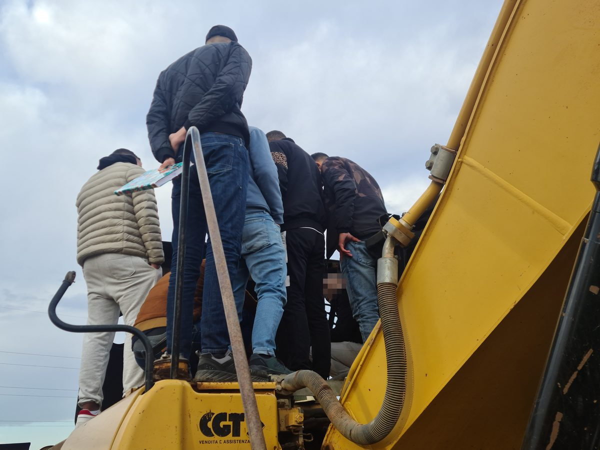 Sur la pelle CAT : on monte sur la machine pour repérer ses organes.</td>
<td width="33%" valign="top"> Sur le capot de la pelle SANY : on pointe, on identifie, on vérifie.</td>
<td width="33%" valign="top"> Autour d'un moteur démonté, en blouse de TP.</td>
</tr>
<tr>
<td width="33%" valign="top"> Au pied de la flèche d'une pelle SANY : observation et discussion en petit groupe.</td>
<td width="33%" valign="top">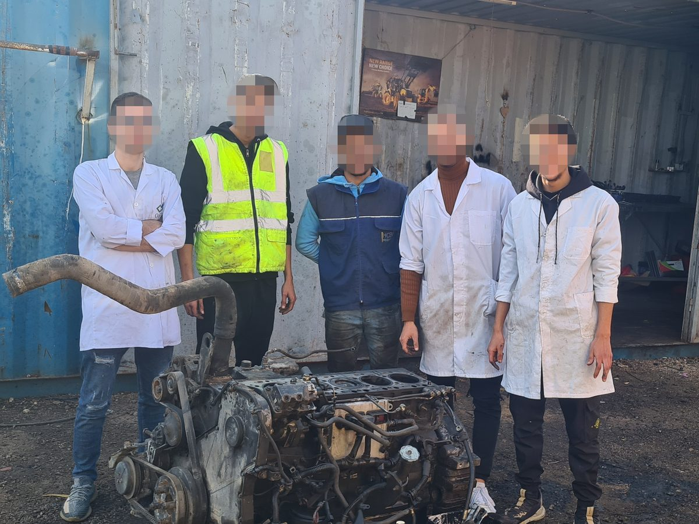 Une équipe en blouse de TP, devant le moteur démonté.</td>
<td width="33%" valign="top">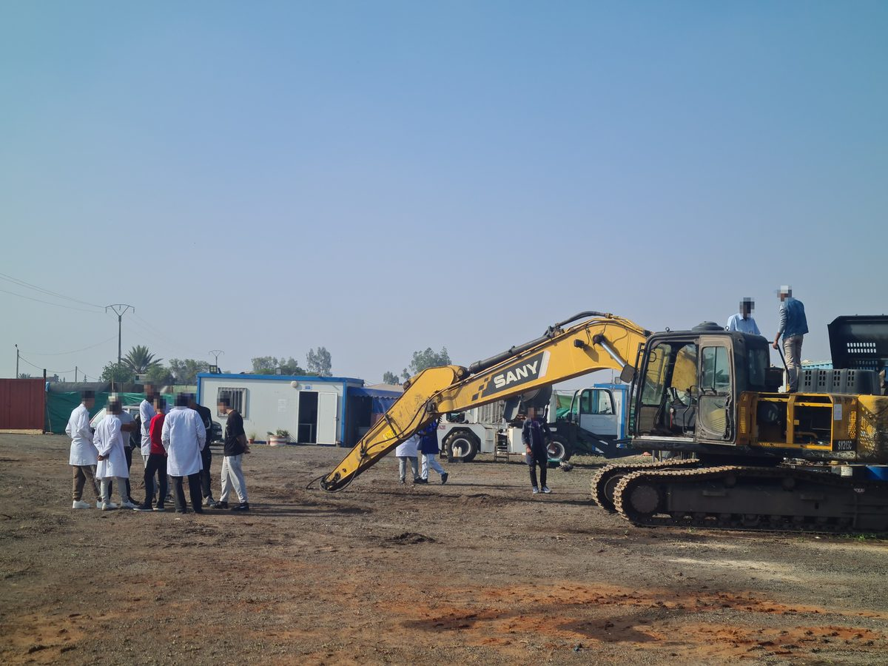 Séance sur la pelle SANY : un groupe au pied de la machine, deux participants sur la tourelle.</td>
</tr>
</table>

### 🚜 Les machines

<table>
<tr>
<td width="33%" valign="top"> Pelle SANY, flèche déployée : au TP, on commence par repérer vérins, pompes et distributeur.</td>
<td width="33%" valign="top"> Pelle SANY SY 215C, sujet n° 01 de la liste des mini-projets.</td>
<td width="33%" valign="top"> Le parc de machines : plusieurs engins et plusieurs marques à comparer, dont une DOOSAN.</td>
</tr>
</table>

### 🔩 Les composants

<table>
<tr>
<td width="33%" valign="top"> Pompe hydraulique dans son compartiment : bride, orifices et flexibles à repérer.</td>
<td width="33%" valign="top"> Compartiment des pompes d'une SANY : pompe, filtre et flexibles réunis dans un même caisson.</td>
<td width="33%" valign="top"> Filtre à bol transparent : le dépôt se voit sans rien démonter.</td>
</tr>
<tr>
<td width="33%" valign="top"> Pompe à pistons axiaux démontée : barillet, pistons à patins, arbre et plaques.</td>
<td width="33%" valign="top"> Pompe double à pistons axiaux en coupe : deux barillets et leurs organes de régulation.</td>
<td width="33%" valign="top"> Ensemble moteur hydraulique et réducteur à engrenages, en coupe.</td>
</tr>
</table>

---

## 🧭 Prérequis et évaluation

| | |
|---|---|
| **Prérequis** | Mécanique générale (forces, travail, puissance) et mathématiques de base — aucun acquis en hydraulique n'est supposé. |
| **Niveau** | Débutant → intermédiaire. |
| **Chaque chapitre** | Quatre énigmes d'accroche → feuille de route → cours et exercices corrigés → synthèse et pièges à éviter → QCM d'auto-évaluation → checklist « Prêt pour le TP ? ». |
| **Évaluation** | QCM d'auto-évaluation en fin de chapitre, TD corrigés, manipulations en TP. |
| **TP** | Sur banc d'essai ou sur machine : le repère **TP** en haut à droite des diapos signale la notion que vous manipulerez. |

---

## 🗓️ Mises à jour

<i>Historique de la page</i>

 

- **8 nov. 2026** — chapitres 4 « Circuits hydrauliques » (71 pages, 9 exercices corrigés) et 5 « Maintenance des installations » (90 pages, 7 exercices corrigés) en ligne, avec leur mémento : les cinq chapitres du module sont publiés
- **7 nov. 2026** — 5e simulation 3D : les filtres et le rapport β (efficacité, colmatage, by-pass, exercice 2)
- **7 nov. 2026** — simulations 3D : distributeurs, vérins, pompes et accumulateur à manipuler en coupe
- **2 nov. 2026** — chapitre 3 « Technologie des systèmes hydrauliques » en ligne : 115 pages, 9 exercices corrigés, 5 TP
- **2 nov. 2026** — galerie de photos de TP, énigmes de terrain et mémento du technicien
- **1er nov. 2026** — liste des 28 sujets de mini-projets et exemple de présentation
- **27 oct. 2026** — vidéo du chapitre 2
- **26 oct. 2026** — chapitre 2 « Schémas hydrauliques et pneumatiques » en ligne
- **24 oct. 2026** — ouverture de la page, chapitre 1 « Généralités sur les systèmes hydrauliques »

---

## 📫 Contact

Page générée par <code>tools/build_hydraulique.py</code> · dernière mise à jour : 8 nov. 2026

