

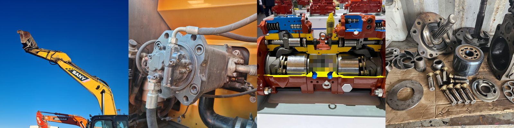

**Pr. Mohamed JANANE ALLAH**, PhD 
École Nationale Supérieure d'Arts et Métiers (ENSAM) — Casablanca

🎓 **Public :** Licence Professionnelle Universitaire *Ingénierie Mécanique et Productique Industrielle* (IMPI)

 

[**Plan du module**](#-plan-du-module) · [**Mini-projets**](#-mini-projets) · [**En images**](#-le-module-en-images) · [**Prérequis et évaluation**](#-prérequis-et-évaluation) · [**Contact**](#-contact)

---

## 🎯 Compétences visées par le module

À l'issue des cinq chapitres, vous saurez :

1. ✅ **comprendre les bases de l'hydraulique** ;
2. ✅ **connaître les composants** d'un circuit ;
3. ✅ **concevoir un circuit** de base ;
4. ✅ **découvrir la technologie** des systèmes hydrauliques ;
5. ✅ **assurer la maintenance** des installations.

---

## 📚 Plan du module

🟦 chapitre en ligne · ⬜ à venir · 🟪 mini-projets

| # | Chapitre | 📄 Cours | 🎥 Vidéo |
|:-:|----------|:--------:|:--------:|
| **01** | Généralités sur les systèmes hydrauliques | [PDF](hydraulique/Chapitre_01_Generalites_systemes_hydrauliques/1_Cours_chapitre_01.pdf) | — |
| **02** | Schémas hydrauliques et pneumatiques | [PDF](hydraulique/Chapitre_02_Schemas_hydrauliques_pneumatiques/1_Cours_chapitre_02.pdf) | [▶ Voir](https://drive.google.com/file/d/1kPl1OZvTW4uxDxojUoDT9yeFKKKwBmKj/view) |
| **03** | Technologie des systèmes hydrauliques | [PDF](hydraulique/Chapitre_03_Technologie_systemes_hydrauliques/1_Cours_chapitre_03.pdf) | — |
| **04** | *Circuits hydrauliques* | 🚧 À venir | — |
| **05** | *Maintenance des installations* | 🚧 À venir | — |

> 📘 Les chapitres sont publiés au fur et à mesure ; 🚧 signale un chapitre pas encore en ligne.

<i>Descriptif des chapitres publiés</i>

 

**01 — Généralités sur les systèmes hydrauliques** · 71 pages  
Hydraulique face au pneumatique et à l'électrique, chaîne d'énergie, grandeurs hydrauliques (pression, débit, force, puissance, rendement), Bernoulli, viscosité, régimes d'écoulement, compressibilité et pertes de charge. Durée indicative 6 à 8 h, applications chiffrées et TD corrigés intégrés, QCM d'auto-évaluation.

*Les huit parties du chapitre, une question chacune :*

1. **Hydraulique et pneumatique** — Pourquoi choisir l'huile plutôt que l'air ?
2. **Énergie mécanique et hydraulique** — Comment l'énergie circule-t-elle de la source à la charge ?
3. **Grandeurs hydrauliques** — Comment calculer pression, débit, force, puissance ?
4. **Fluides en mouvement** — Que devient l'énergie le long d'une conduite ?
5. **Viscosité** — Pourquoi une huile trop épaisse ou trop fluide change tout ?
6. **Régimes d'écoulement** — L'écoulement est-il laminaire ou turbulent ?
7. **Compressibilité et dilatation** — L'huile est-elle vraiment incompressible ?
8. **Pertes de charge** — Combien de pression perd-on en route ?

*Les TP associés, sur machine :*

- **TP 1 — Lire la machine** : repérer moteur, pompes, distributeur, vérins ; lire plaques et symboles
- **TP 2 — Pression et force** : lire un manomètre, relever la pression de tarage, calculer F = p · S
- **TP 3 — Débit et vitesse** : chronométrer une course de vérin et en déduire Q = S · v
- **TP 4 — Huile et température** : relever la température, lire la fiche d'huile, estimer le régime (Re)
- **TP 5 — Pertes et diagnostic** : mesurer Δp d'un filtre ou d'un flexible, lire le vacuomètre d'aspiration

**02 — Schémas hydrauliques et pneumatiques** · 73 pages  
Symboles normalisés (ISO 1219) des pompes, vérins, distributeurs, clapets et limiteurs ; lecture d'un distributeur et chemin du fluide ; régulation de pression et de débit ; règles de représentation et de repérage ; construction d'un circuit simple à partir d'un cahier des charges. Exemple fil rouge : commande d'un vérin hydraulique à double effet. Durée indicative 5 à 7 h, exercices corrigés, QCM d'auto-évaluation.

*Les six parties du chapitre, une question chacune :*

1. **Le langage du schéma** — Comment dessine-t-on des lignes, un réservoir, une source ?
2. **Régulation et protection** — Comment limiter la pression et régler le débit ?
3. **Distribution de l'énergie** — Comment aiguiller le fluide vers le bon actionneur ?
4. **Conversion de l'énergie** — Comment représenter pompes, moteurs et vérins ?
5. **Mesure et appareils complémentaires** — Comment voir ce qui se passe dans le circuit ?
6. **Lire et dessiner un schéma complet** — Comment lire, puis construire un circuit ?

*Les TP associés, sur machine :*

- **TP 1 — Lire la machine** : retrouver sur le schéma constructeur les symboles et leurs repères
- **TP 2 — Identifier les composants** : associer chaque symbole à un composant du banc : plaques, orifices
- **TP 3 — Câbler un circuit** : réaliser la commande d'un vérin double effet et vérifier les 3 positions
- **TP 4 — Régler et mesurer** : tarer le limiteur de pression, régler la vitesse, lire les manomètres
- **TP 5 — Dessiner et simuler** : dessiner le schéma d'une application et le valider, par simulation si possible

**03 — Technologie des systèmes hydrauliques** · 115 pages  
Les composants d'une installation, famille par famille : centrale, réservoirs, filtres, accumulateurs, pompes, moteurs, vérins, distributeurs, protection et régulation. Calculs de cylindrée, débit, couple et rendements, volume d'un accumulateur, effort et flambage d'un vérin, dimensionnement d'une centrale ; diagnostic des symptômes types (cavitation, colmatage, usure interne). Durée indicative 12 à 16 h hors TP, 9 exercices corrigés, fiches de formules, QCM d'auto-évaluation.

*Les neuf parties du chapitre, une question chacune :*

1. **Centrale hydraulique** — Comment est organisé le groupe de puissance ?
2. **Réservoirs** — Quel volume, quelles règles de conception ?
3. **Filtres** — Où placer le filtre et avec quelle finesse ?
4. **Accumulateurs** — Comment stocker l'énergie et l'amortir ?
5. **Pompes** — Quel type, quelle cylindrée, quel rendement ?
6. **Moteurs hydrauliques** — Quel couple, quelle vitesse ?
7. **Vérins** — Quel effort, quelle tige, quelle course ?
8. **Distributeurs** — Quelle taille, quelle commande ?
9. **Protection et régulation** — Comment limiter la pression et le débit ?

*Les TP associés, sur machine :*

- **TP 1 — Identifier** : nommer les composants d'une centrale ou d'une machine ; relever les plaques
- **TP 2 — Mesurer une pompe** : relever Q, p, N et C ; calculer ηv, ηhm et ηg
- **TP 3 — Accumulateur et filtre** : lire la précharge (hors pression), l'indicateur de colmatage, l'état du filtre
- **TP 4 — Vérin et moteur** : chronométrer une course, calculer F, v et le débit ; repérer le gavage
- **TP 5 — Distributeur et limiteur** : identifier la commande, câbler, tarer le limiteur et mesurer Δp

---

## 🧩 Mini-projets

Chaque étudiant (ou chaque groupe) étudie **une machine réelle** et décrit son système hydraulique complet : le circuit, le réservoir et sa filtration, les pompes, puis les autres composants. Le travail mobilise les cinq chapitres du cours et les TP.

| | |
|---|---|
| **📋 Les 28 sujets** | [Liste des mini-projets (PDF)](hydraulique/Mini_projet/Liste_28_sujets_mini_projets.pdf) · 2 pages · 118 Ko |
| **📊 Un exemple** | [Présentation de 15 min : pelle DOOSAN Solar 225LC-V (PowerPoint)](hydraulique/Mini_projet/Exemple_presentation_mini_projet_DOOSAN_Solar_225LC-V.pptx) · 20 diapositives · 3,1 Mo |

**Les 28 sujets**, en six familles : terrassement et BTP (7), levage et manutention (6), véhicules utilitaires et poids lourds (5), agriculture (2), industrie (5), énergie, eau et air (3). Les architectures indiquées sont des cas courants, à confirmer sur le schéma constructeur du modèle choisi ; les valeurs chiffrées se relèvent sur la plaque, la fiche technique ou le manuel.

**Dans l'exemple de présentation** : 18 diapositives minutées (plus une annexe et les crédits hors minutage), sur le plan Introduction · Réservoir · Filtration · Pompes · Autres composants · Circuit · Maintenance · Conclusion. Il montre comment rattacher chaque partie à un chapitre du cours et à une section du manuel de service, recouper des fiches techniques et refaire sur une machine réelle les calculs du cours (volume du réservoir, régulation de puissance, effort d'un vérin, bilan de puissance). C'est un exemple pédagogique : ses valeurs viennent de fiches publiques et sont à remplacer par les relevés de la machine étudiée ; il renvoie aux chapitres 1 à 5 du cours, dont les chapitres 4 et 5 ne sont pas encore en ligne.

---

## 📸 Le module en images

Le module se vit sur machines réelles : lire la machine, mesurer, démonter, vérifier. *Visages floutés pour respecter l'image des étudiants.*

### 🚜 Les machines

<table>
<tr>
<td width="33%" valign="top">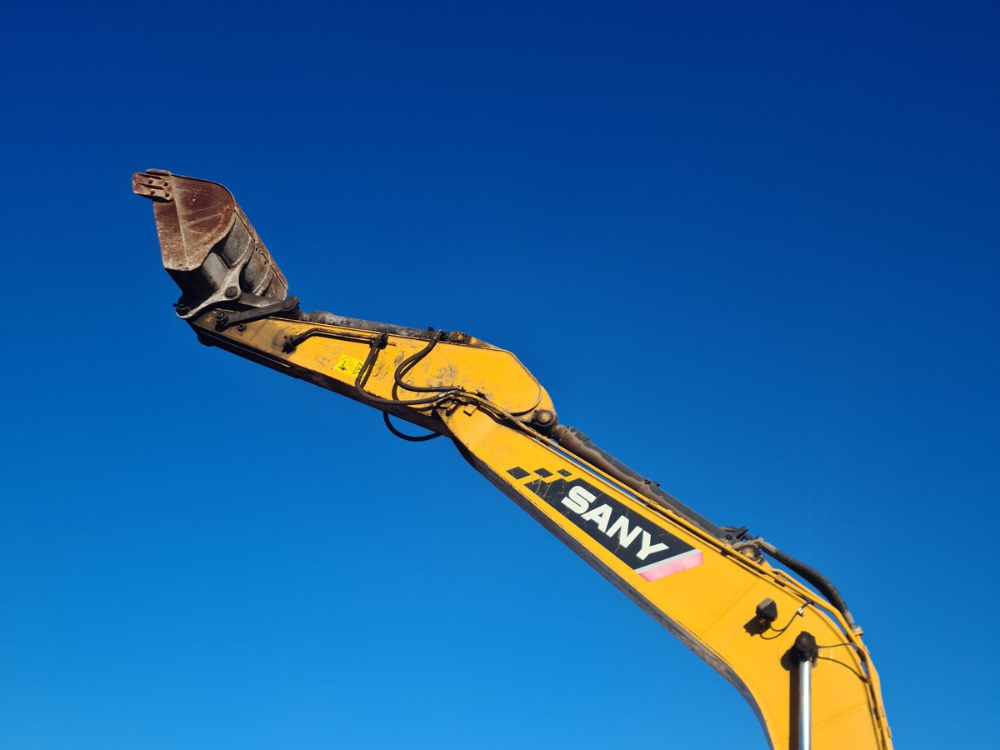 Pelle SANY, flèche déployée : au TP, on commence par repérer vérins, pompes et distributeur.</td>
<td width="33%" valign="top">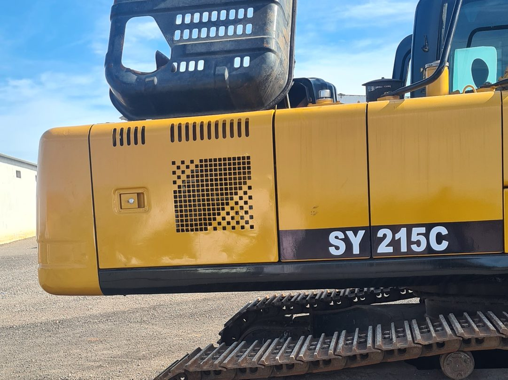 Pelle SANY SY 215C, sujet n° 01 de la liste des mini-projets.</td>
<td width="33%" valign="top">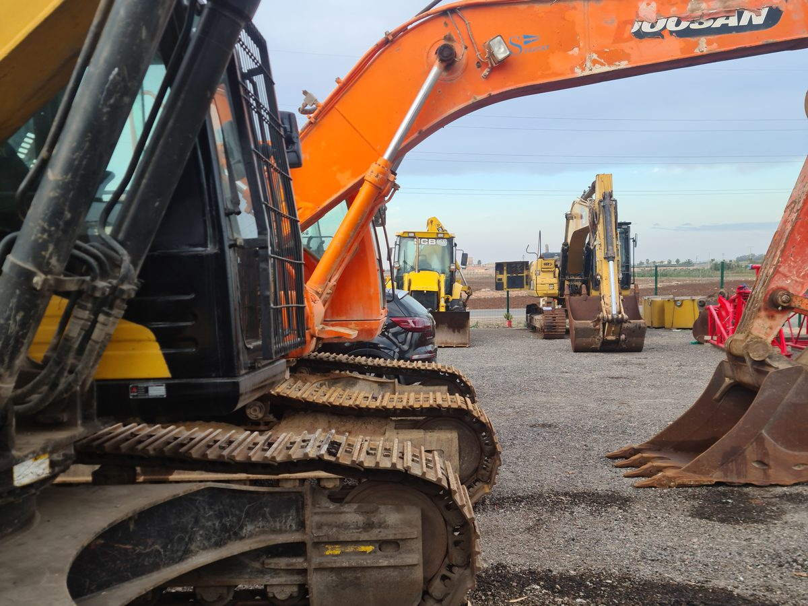 Le parc de machines : plusieurs engins et plusieurs marques à comparer, dont une DOOSAN.</td>
</tr>
</table>

### 🔩 Les composants

<table>
<tr>
<td width="33%" valign="top">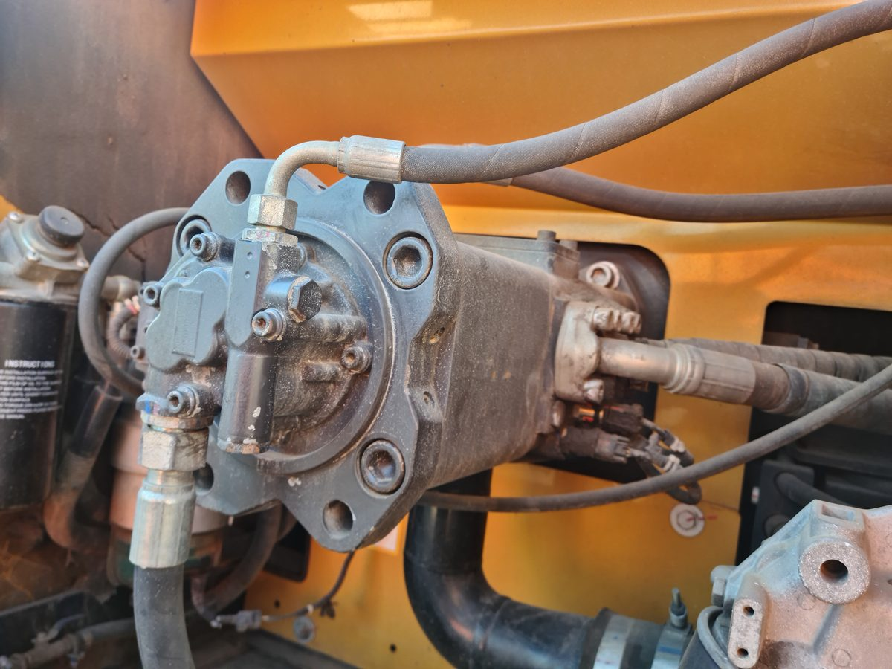 Pompe hydraulique dans son compartiment : bride, orifices et flexibles à repérer.</td>
<td width="33%" valign="top">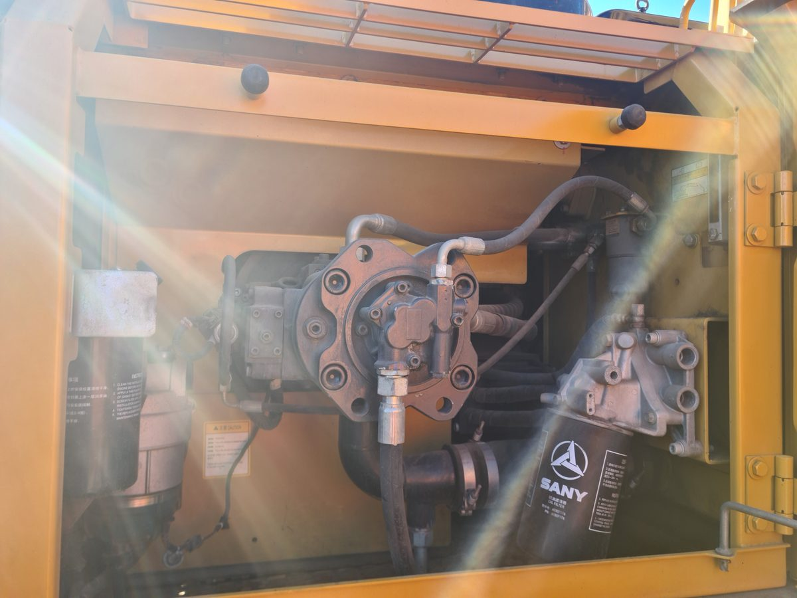 Compartiment des pompes d'une SANY : pompe, filtre et flexibles réunis dans un même caisson.</td>
<td width="33%" valign="top">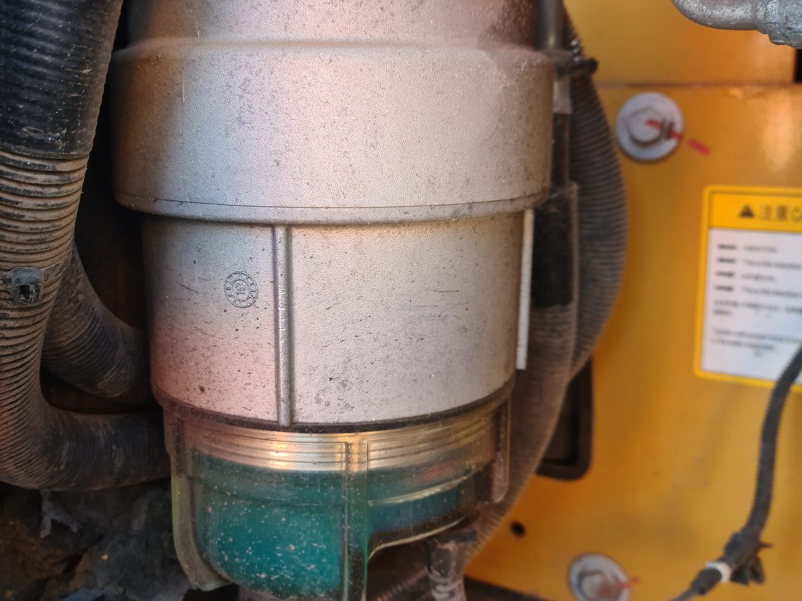 Filtre à bol transparent : le dépôt se voit sans rien démonter.</td>
</tr>
<tr>
<td width="33%" valign="top">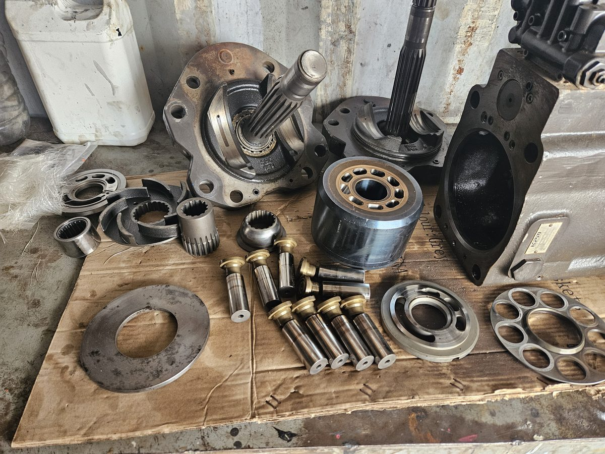 Pompe à pistons axiaux démontée : barillet, pistons à patins, arbre et plaques.</td>
<td width="33%" valign="top">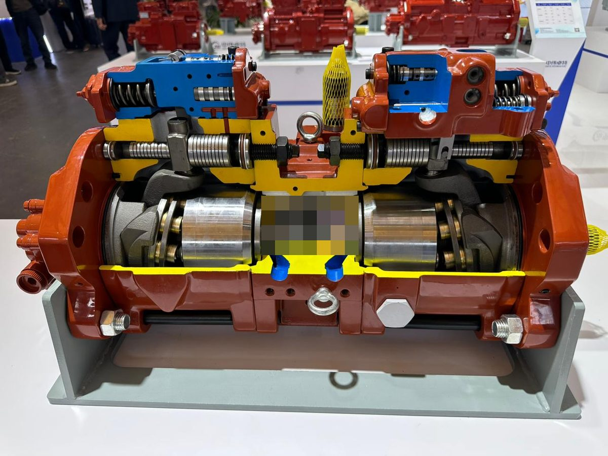 Pompe double à pistons axiaux en coupe : deux barillets et leurs organes de régulation.</td>
<td width="33%" valign="top">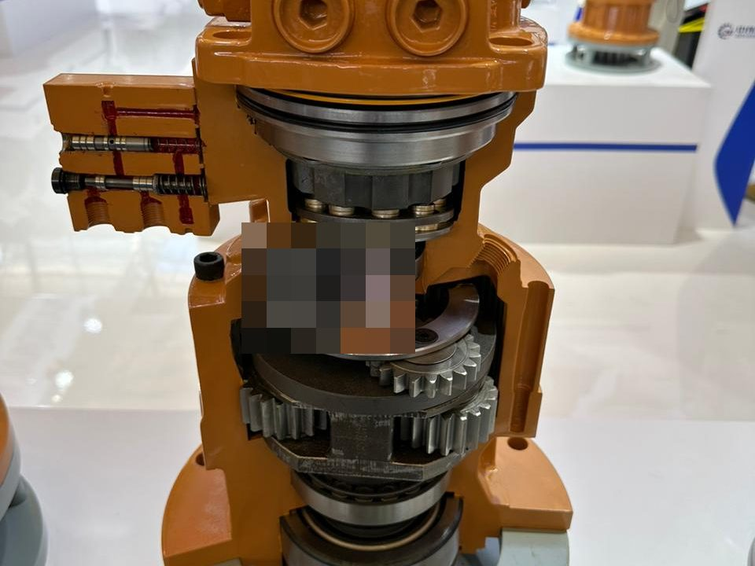 Ensemble moteur hydraulique et réducteur à engrenages, en coupe.</td>
</tr>
</table>

### 👷 Sur le terrain

<table>
<tr>
<td width="50%" valign="top">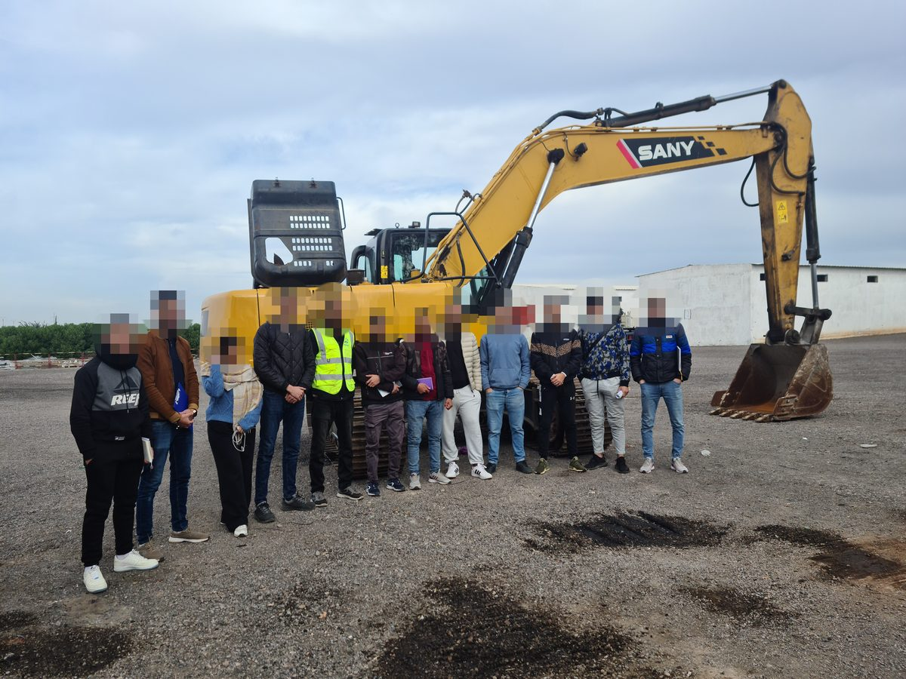 Une partie du groupe devant la pelle SANY.</td>
<td width="50%" valign="top">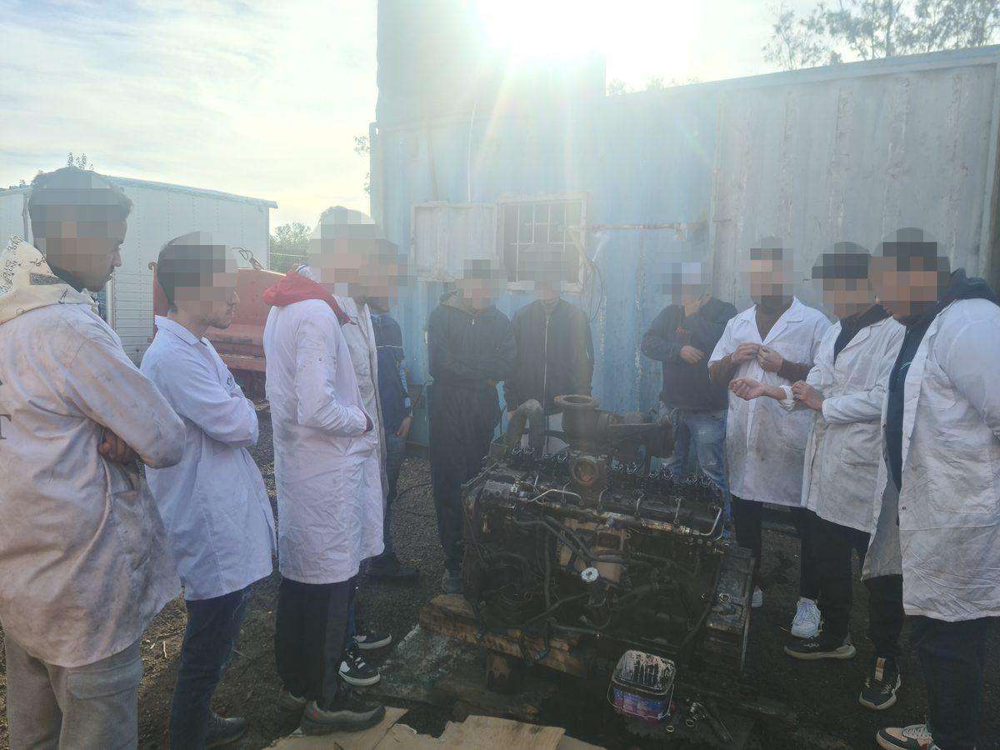 Autour d'un moteur démonté, en blouse de TP.</td>
</tr>
<tr>
<td width="50%" valign="top">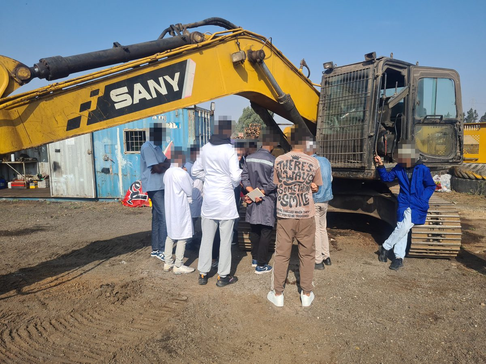 Au pied de la flèche d'une pelle SANY : observation et discussion en petit groupe.</td>
<td width="50%" valign="top"> Sur la machine : on pointe, on identifie, on vérifie.</td>
</tr>
</table>

---

## 🧭 Prérequis et évaluation

| | |
|---|---|
| **Prérequis** | Mécanique générale (forces, travail, puissance) et mathématiques de base — aucun acquis en hydraulique n'est supposé. |
| **Niveau** | Débutant → intermédiaire. |
| **Évaluation** | QCM d'auto-évaluation en fin de chapitre, TD corrigés, manipulations en TP. |
| **TP** | Sur banc d'essai : le repère **TP** en haut à droite des diapos signale la notion que vous manipulerez sur machine. |

---

## 📫 Contact

