[⬅ Profil](../README.md) › Enseignement › **Introduction aux méthodes numériques** · Cycle d'Ingénieur GE

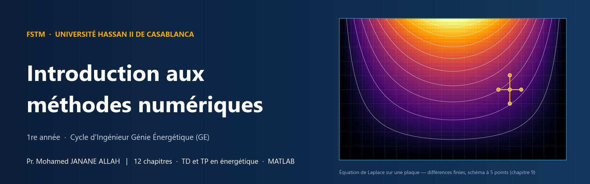

 

Résoudre sur ordinateur les problèmes de l'énergétique qu'on ne sait pas résoudre à la main : 
**systèmes linéaires et non linéaires** (réseaux thermiques et hydrauliques), **équations aux dérivées partielles**
par différences finies (conduction, convection), **équations différentielles ordinaires** (dynamique thermique).

🎓 1ʳᵉ année du Cycle d'Ingénieur Génie Énergétique (GE) — FSTM, Université Hassan II de Casablanca · 🔒 vidéos accessibles avec le compte universitaire UH2C

<table>
<tr>
<td align="center" width="20%"><b>📚 12 modules</b> 144 pages de cours</td>
<td align="center" width="20%"><b>🎥 14 vidéos</b> cours et TP GE</td>
<td align="center" width="20%"><b>⚡ 3 TD · 2 TP GE</b> jusqu'au chapitre 3</td>
<td align="center" width="20%"><b>🎮 10 jeux</b> TP1 et TP2 GE</td>
<td align="center" width="20%"><b>⏱️ 48 h</b> 5 TP MATLAB</td>
</tr>
</table>

[**À propos**](#-à-propos) · [**Programme**](#-programme-du-module) · [**🎮 Jeux**](#-jeux-interactifs) · [**Enseignant**](#-enseignant) · [**Questions fréquentes**](#-questions-fréquentes)

---

## 📌 À propos

Ce module donne à l'ingénieur énergéticien les outils numériques qui permettent de résoudre, sur ordinateur, ce
qu'on ne sait pas résoudre à la main : **systèmes linéaires** (méthodes directes et itératives), **systèmes non
linéaires**, **équations aux dérivées partielles** par différences finies, et **équations différentielles ordinaires**.

> ⚡ **Ce qui est propre au Cycle GE** : le cours (PDF et vidéos) est le même que celui de la LST Génie Mécanique ;
> les **TD**, les **TP** et les **jeux** sont écrits dans un contexte énergétique (bâtiments, fours, réseaux de chaleur).
> Mise à jour du 25 nov. 2026 : **jusqu'au chapitre 3** ; les modules suivants recevront leurs TD et TP GE au fur et à mesure.

#### Ce que vous apprendrez

<table>
<tr><td width="50%" valign="top">✔️ Choisir une méthode adaptée à la taille et à la structure du problème</td><td width="50%" valign="top">✔️ Estimer la précision d'un résultat et reconnaître un calcul qui diverge</td></tr>
<tr><td width="50%" valign="top">✔️ Programmer ces méthodes en MATLAB et valider un schéma sur un cas test analytique</td><td width="50%" valign="top">✔️ Interpréter physiquement les conditions de stabilité (CFL, critères de convergence)</td></tr>
</table>

#### Détails à connaître

| 🎓 Public | ⏱️ Volume | 🧩 Prérequis | 💻 Logiciel | 🗣️ Langue |
|---|---|---|---|---|
| 1ʳᵉ année du Cycle d'Ingénieur Génie Énergétique (GE), FSTM | 48 h · 5 TP (TP1 à TP5) | Algèbre linéaire, analyse (développements de Taylor), bases de MATLAB | MATLAB | Français |

---

## 📚 Programme du module

Il y a **12 modules**, en trois parties précédées d'une introduction. Pour chaque module : le cours et sa vidéo
(communs), puis, quand ils sont en ligne, le TD, le TP, son corrigé, sa vidéo et ses jeux en version GE (⚡).

🔵 cours (PDF) · 🟣 TD GE · 🔴 énoncé de TP GE · 🟢 corrigé (scripts MATLAB) · 🟠 vidéo (compte UH2C) · 🟡 jeux interactifs

### 🚩 Introduction

1 module · 8 pages de cours

#### Module 00 · Introduction générale

Pourquoi le calcul numérique en mécanique, et à quoi il sert concrètement dans le métier d'ingénieur. Présentation des exemples fils conducteurs du module.

⚡ En énergétique : Quatre cas chiffrés : pompage, solaire, four, réseau.

### 🧮 Partie I — Systèmes algébriques

4 modules · 59 pages de cours

#### Module 01 · Rappels numériques : erreurs, normes et conditionnement

Un ordinateur ne calcule jamais exactement : erreurs d'arrondi, normes vectorielles et matricielles, conditionnement d'une matrice.

⚡ En énergétique : Bilans d'énergie et rendements : soustraction de grandeurs voisines, arrondi, conditionnement d'un bilan thermique.

#### Module 02 · Systèmes linéaires : méthodes directes

Résolution de Ax = b en un nombre fini d'opérations — la brique de base de tout calcul par éléments finis.

⚡ En énergétique : Réseau thermique nodal d'un bâtiment multizone ; réseau hydraulique maillé.

#### Module 03 · Systèmes linéaires : méthodes itératives

Pour les grands systèmes creux issus d'un maillage fin, là où l'élimination de Gauss coûte trop cher et détruit le caractère creux (fill-in).

⚡ En énergétique : Conduction 2D dans un four ou une plaque : grands systèmes creux (Jacobi, Gauss-Seidel, SOR).

#### Module 04 · Systèmes non linéaires

Résoudre F(x) = 0 quand la physique cesse d'être linéaire : pertes de charge quadratiques, ressort durcissant, grandes déformations.

⚡ En énergétique : Colebrook (pertes de charge), bilan radiatif en T⁴, point de fonctionnement pompe-réseau : Newton.

### 🌡️ Partie II — EDP et différences finies

6 modules · 63 pages de cours

#### Module 05 · Généralités sur les EDP en mécanique et classification

L'inconnue n'est plus un vecteur mais un champ. Classification elliptique / parabolique / hyperbolique et conditions aux limites associées.

⚡ En énergétique : Chaleur, convection-diffusion, Poisson, ondes : un phénomène énergétique pour chaque type d'EDP.

#### Module 06 · Principe de la méthode des différences finies

L'étape décisive : remplacer les dérivées, objets continus, par des quantités calculables sur ordinateur.

⚡ En énergétique : Paroi de four (fil rouge), ailette : de l'équation au système A T = b.

#### Module 07 · Consistance, stabilité, convergence

Pourquoi un schéma parfaitement construit sur le papier peut produire des résultats absurdes — des oscillations qui grandissent jusqu'à faire déborder les calculs.

⚡ En énergétique : Seuil r ≤ 1/2 sur la paroi réfractaire ; CFL pour le transport de chaleur par un fluide.

#### Module 08 · Équation de la chaleur

Un problème physique résolu de bout en bout : la paroi de four en régime transitoire, de l'état initial jusqu'à l'équilibre.

⚡ En énergétique : Paroi, ailette, stockage thermique ; schémas explicite, implicite, θ.

#### Module 09 · Équation de Laplace-Poisson et advection-diffusion

Discrétisation 2D complète (Dirichlet puis Neumann), validation sur un cas test analytique, puis introduction de l'advection-diffusion.

⚡ En énergétique : Champ de température d'un bâtiment (2D) ; échangeur et nombre de Péclet.

#### Module 10 · Équation des ondes

La corde vibrante et sa condition de stabilité — la condition CFL, avec son interprétation géométrique remarquable.

⚡ En énergétique : Vibrations de tuyauteries et d'aubes ; acoustique d'un conduit.

### 📈 Partie III — Équations différentielles ordinaires

1 module · 14 pages de cours

#### Module 11 · Résolution numérique des équations différentielles ordinaires

L'évolution temporelle des systèmes à nombre fini de degrés de liberté : oscillateurs, mécanismes, circuits équivalents.

⚡ En énergétique : Dynamique thermique d'un four ou d'un ballon de stockage ; raideur et choix du pas.

---

## 🎮 Jeux interactifs

Des jeux, dans le navigateur, pour **manipuler un TP avant de le programmer**. Tous les nombres affichés sont calculés
en direct par le code MATLAB du TP, porté ligne pour ligne en JavaScript : ce sont les mêmes que dans MATLAB.

### TP1 GE · Module 02 — le réseau thermique d'un bâtiment (méthodes directes)

<table>
<tr>
<td width="33%" valign="top" align="center"><a href="https://janane-allah.github.io/jeux/tp1-ge/#jeu-1">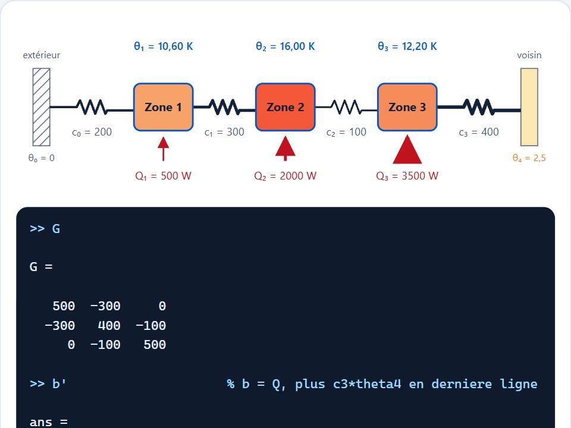</a> <b>1 · Le réseau thermique</b> Assembler G, local voisin chauffé, zone isolée </td>
<td width="33%" valign="top" align="center"><a href="https://janane-allah.github.io/jeux/tp1-ge/#jeu-2">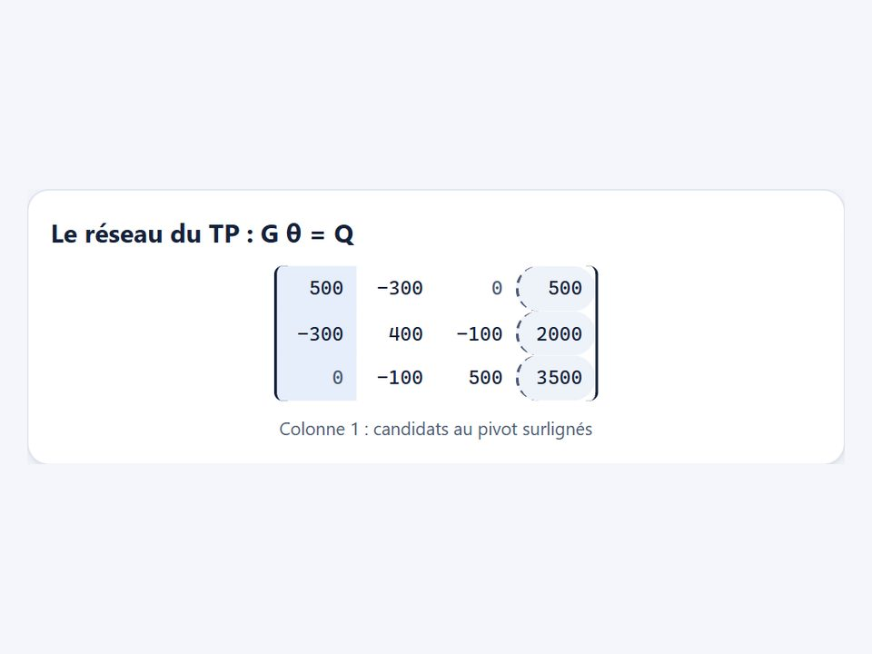</a> <b>2 · Gauss pas à pas</b> Pivot partiel, multiplicateurs, remontée </td>
<td width="33%" valign="top" align="center"><a href="https://janane-allah.github.io/jeux/tp1-ge/#jeu-3">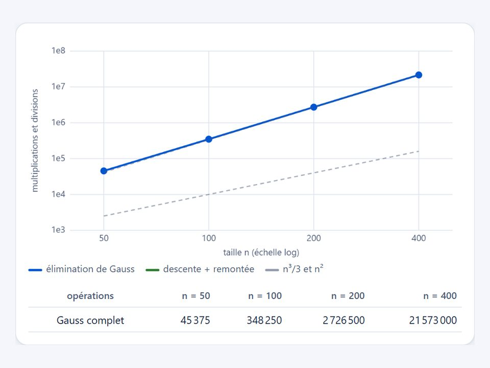</a> <b>3 · Le compteur d'opérations</b> n³/3 pour Gauss, n² par scénario de chauffage </td>
</tr>
<tr>
<td width="33%" valign="top" align="center"><a href="https://janane-allah.github.io/jeux/tp1-ge/#jeu-4">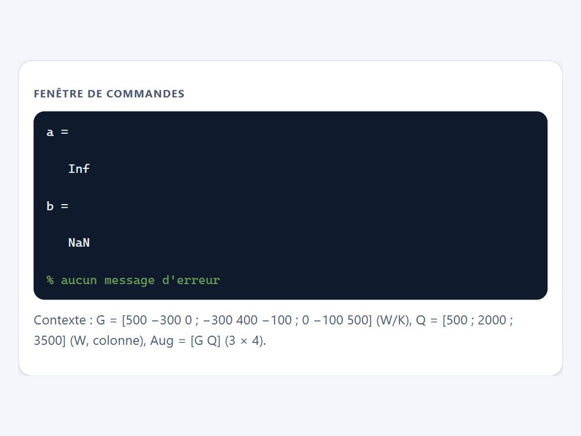</a> <b>4 · Les messages d'erreur</b> Huit vrais messages de MATLAB </td>
<td width="33%" valign="top" align="center"><a href="https://janane-allah.github.io/jeux/tp1-ge/#jeu-5">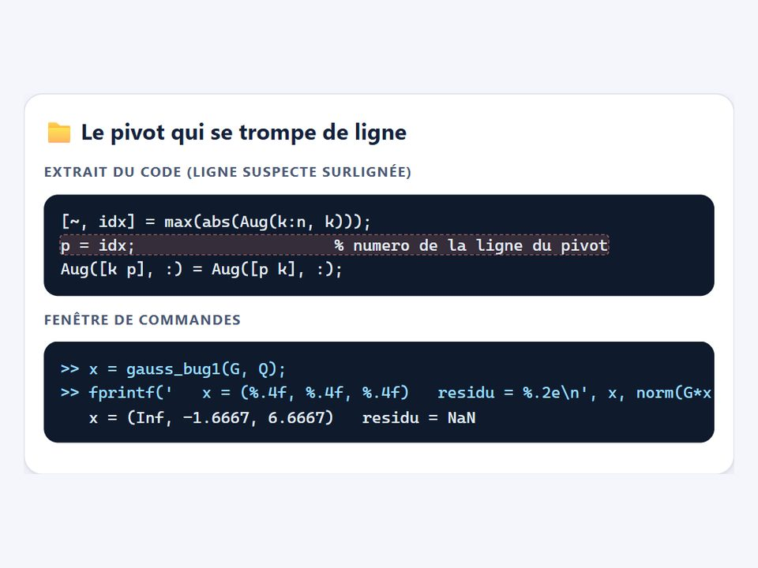</a> <b>5 · Détective du code</b> Les bugs silencieux et le résidu </td>
<td width="33%" valign="top">🏆 <b>Comment jouer</b>  💻📱 Sur ordinateur ou sur téléphone, sans installation ni compte.  ⭐ Jusqu'à 3 étoiles par jeu ; la progression reste dans votre navigateur.  💡 Jouez <b>après</b> avoir lu l'énoncé et <b>avant</b> d'écrire votre code MATLAB.</td>
</tr>
</table>

### TP2 GE · Module 03 — la paroi d'une étuve (méthodes itératives)

<table>
<tr>
<td width="33%" valign="top" align="center"><a href="https://janane-allah.github.io/jeux/tp2-ge/#jeu-1">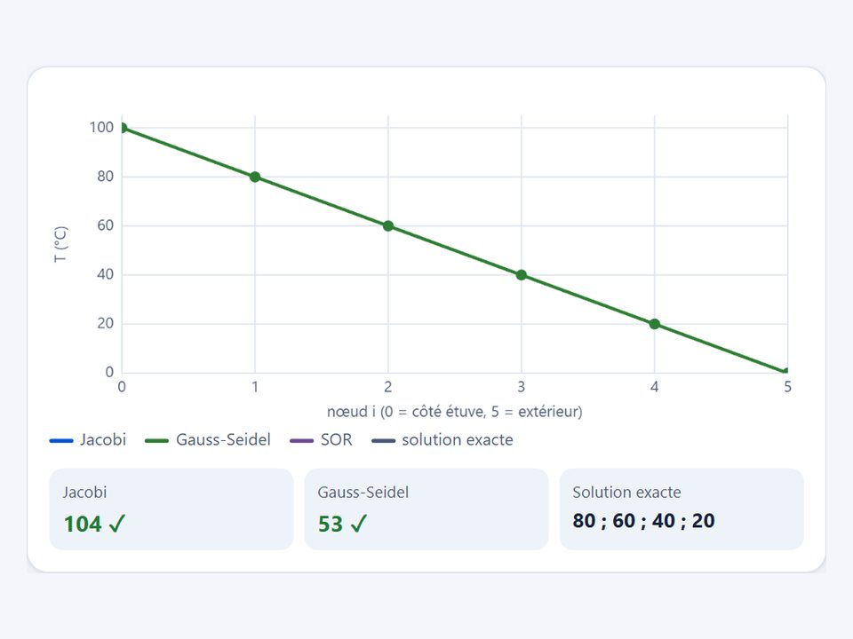</a> <b>1 · Jacobi contre Gauss-Seidel</b> La course, ρ_GS = ρ_J², le flux de chaleur </td>
<td width="33%" valign="top" align="center"><a href="https://janane-allah.github.io/jeux/tp2-ge/#jeu-2">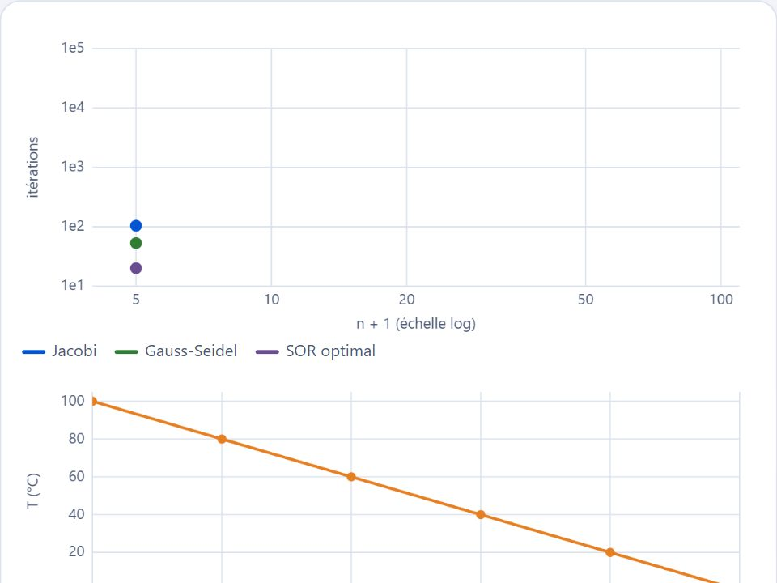</a> <b>2 · La paroi s'affine</b> Le nombre d'itérations quand n augmente </td>
<td width="33%" valign="top" align="center"><a href="https://janane-allah.github.io/jeux/tp2-ge/#jeu-3">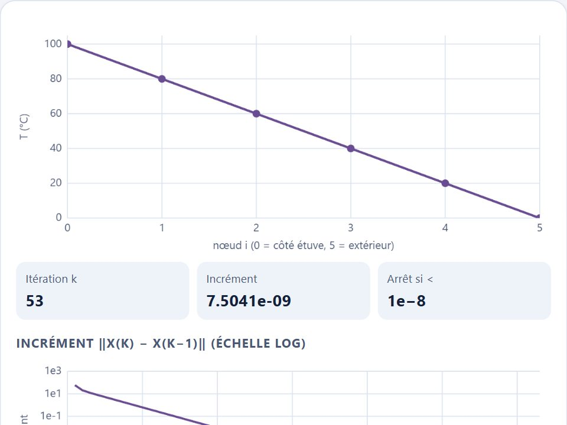</a> <b>3 · La chasse au ω*</b> SOR, formule de Young, courbe asymétrique </td>
</tr>
<tr>
<td width="33%" valign="top" align="center"><a href="https://janane-allah.github.io/jeux/tp2-ge/#jeu-4">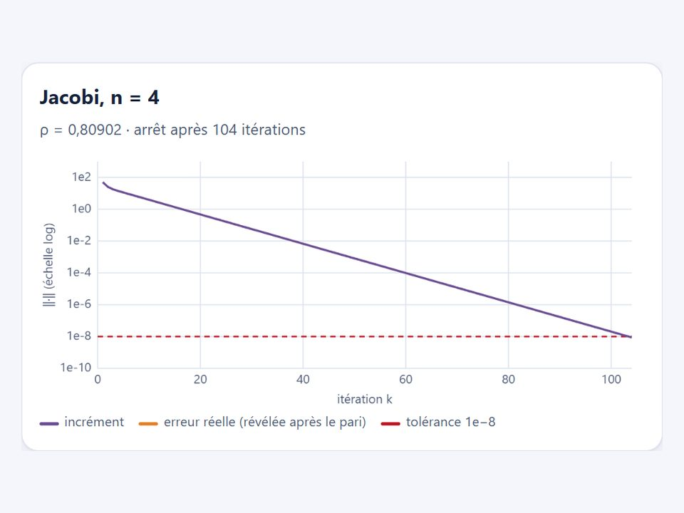</a> <b>4 · Incrément ou erreur ?</b> Le critère d'arrêt et le facteur ρ/(1 − ρ) </td>
<td width="33%" valign="top" align="center"><a href="https://janane-allah.github.io/jeux/tp2-ge/#jeu-5">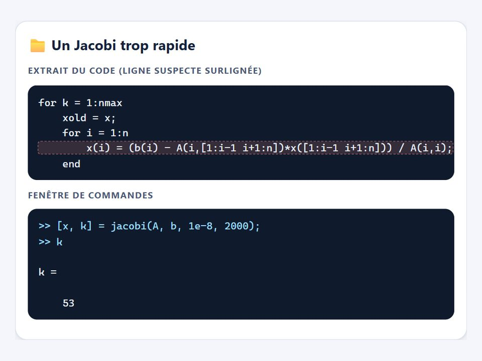</a> <b>5 · Détective du code</b> Avertissements, ω périmé, étuve à l'envers </td>
<td width="33%" valign="top">🏆 <b>Comment jouer</b>  💻📱 Sur ordinateur ou sur téléphone, sans installation ni compte.  ⭐ Jusqu'à 3 étoiles par jeu ; la progression reste dans votre navigateur.  💡 Jouez <b>après</b> avoir lu l'énoncé et <b>avant</b> d'écrire votre code MATLAB.</td>
</tr>
</table>

---

## 👤 Enseignant

<b>Pr. Mohamed JANANE ALLAH</b>, PhD — Maître de Conférence · Faculté des Sciences et Techniques de Mohammedia (FSTM) — Université Hassan II de Casablanca 
🌐 <a href="https://janane-allah.github.io">Site personnel</a> · <a href="mailto:mohamedjanane147@gmail.com">mohamedjanane147@gmail.com</a>

---

## ❓ Questions fréquentes

<b>Pourquoi le cours est-il le même qu'en LST Génie Mécanique ?</b>

 

Le module est mutualisé : les méthodes numériques sont les mêmes de part et d'autre. En Cycle GE, le module
s'intitule *Introduction aux méthodes numériques* (48 h, cinq TP) ; ses TD, ses TP et ses jeux sont propres au GE. La page de la
LST Génie Mécanique reste [ici](licence-genie-mecanique.md).

<b>Comment accéder aux vidéos ?</b>

 

🔒 Connectez-vous à votre **compte universitaire UH2C** avant d'ouvrir un lien vidéo. Si l'accès vous est refusé alors
que vous êtes bien inscrit au module, écrivez-moi.

<b>Quels supports puis-je télécharger ?</b>

 

Les PDF du cours, les énoncés des TD et TP GE et les corrigés de TP (scripts MATLAB, en zip) sont en accès libre.
Le polycopié réunit tout le cours ; ses TD et TP sont ceux de la LST GM : en GE, utilisez les énoncés ⚡ de cette page.

---

Page générée par <code>tools/build_page.py</code> · Université Hassan II de Casablanca — FSTM

