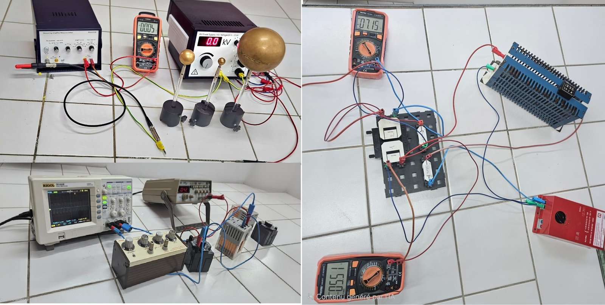
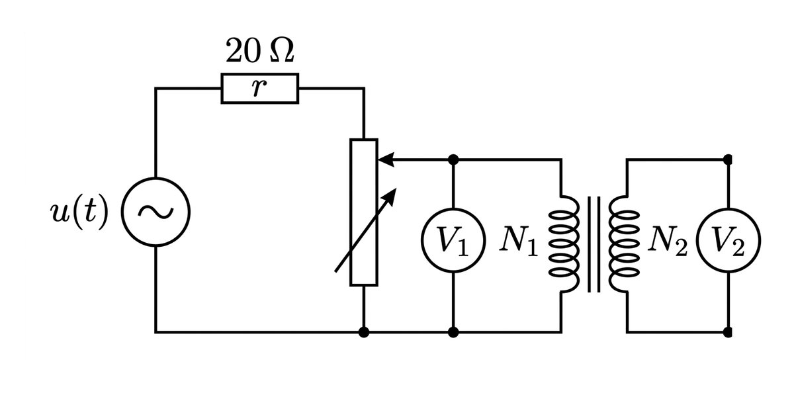
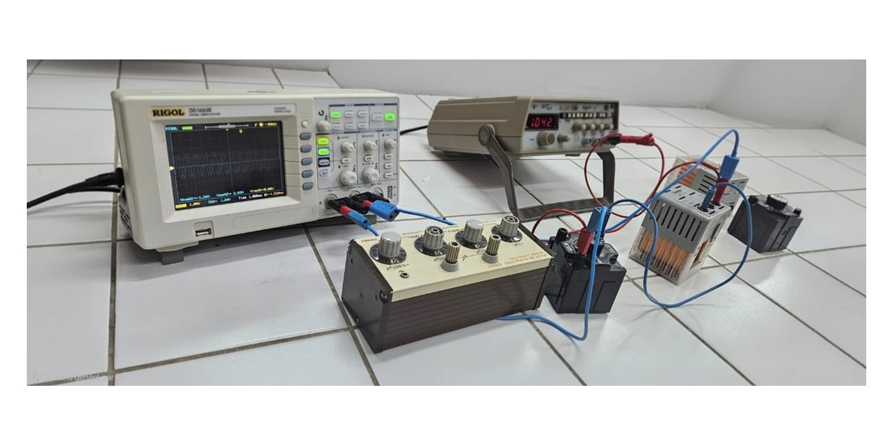
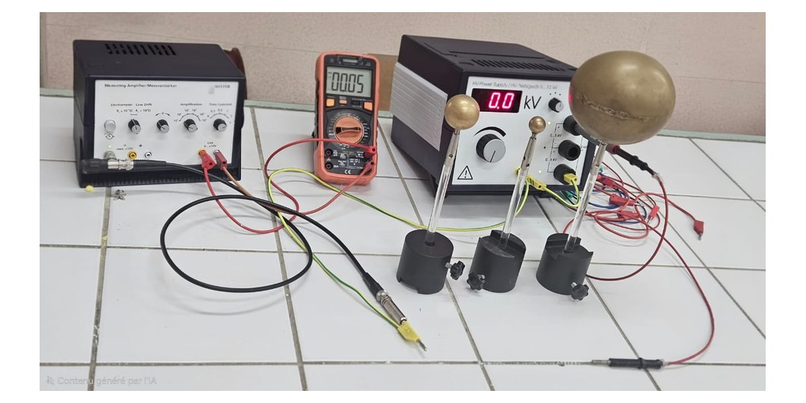
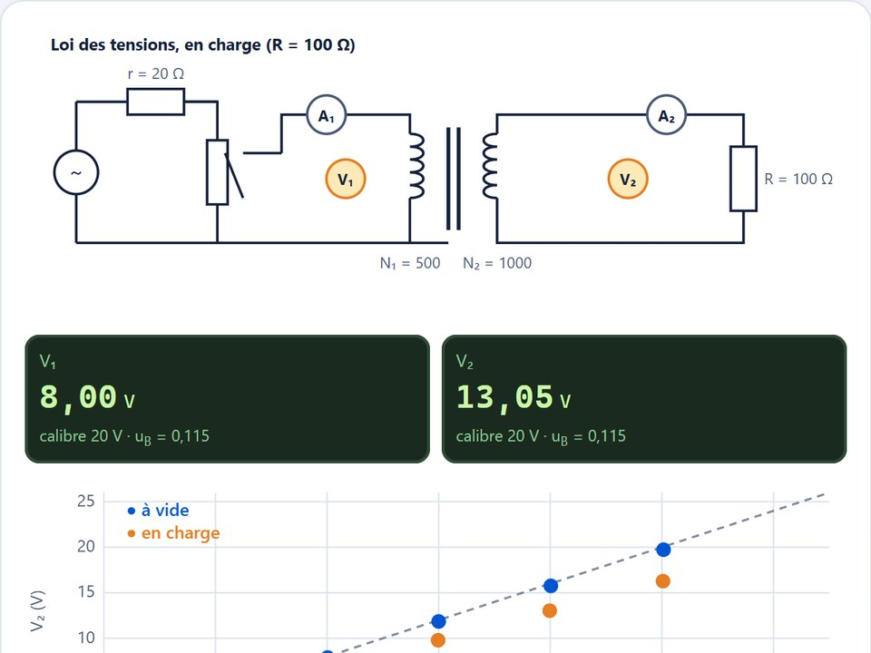
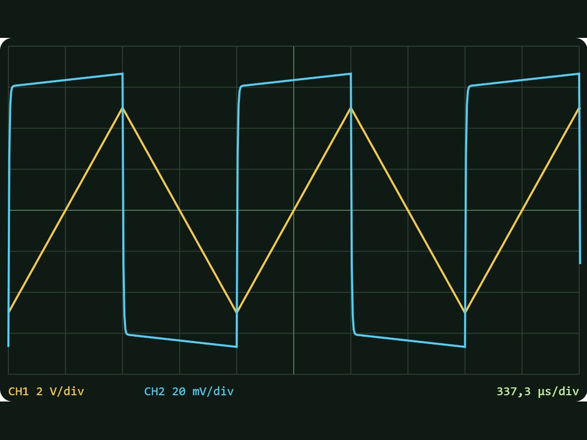
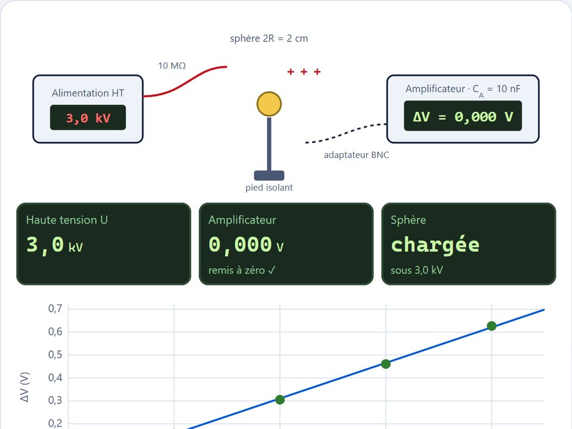

[⬅ Profil](../README.md) › Enseignement › Travaux pratiques › **Électricité**

# ⚡ Travaux pratiques d'électricité

**Modules P121 / P221 « Électricité »** · Tronc commun, 1re année · Semestres S1 et S2 
Faculté des Sciences et Techniques de Mohammedia — Université Hassan II de Casablanca · Année universitaire 2025 – 2026

<table>
<tr>
<td align="center" width="25%"><b>🔬 3 TP</b> en salle de TP</td>
<td align="center" width="25%"><b>🧑‍🎓 1re année</b> GI · GESE · GP · MSD</td>
<td align="center" width="25%"><b>📅 S1 + S2</b> P121 · P221</td>
<td align="center" width="25%"><b>📄 25 pages</b> théorie et manipulations</td>
</tr>
</table>

[**Les TP**](#-les-trois-tp) · [**Avant la séance**](#-avant-la-séance) · [**Mesures et incertitudes**](#-mesures-et-incertitudes) · [**Le compte rendu**](#-le-compte-rendu) · [**Équipe**](#-équipe-pédagogique) · [**🧪 Simulations**](#-simulations-des-trois-manipulations)

---

## 🔬 Les trois TP

Trois expériences fondamentales d'électrocinétique, d'électromagnétisme et d'électrostatique. Chaque TP commence par un rappel de théorie, puis détaille la manipulation et les tableaux de mesures à remplir.

<table>
<tr>
<td width="33%" valign="top"> <b>TP1 · Étude d'un transformateur</b> Vérifier les lois des tensions et des intensités, puis calculer le rendement et les pertes (à vide et en charge) d'un transformateur monophasé.  <code>rapport de transformation m = N₂/N₁</code> · <code>loi des intensités</code> · <code>pertes Joule et pertes fer</code> · <code>rendement ρ = P₂/P₁</code>  📄 pages 7 – 13 du manuel · <a href="https://janane-allah.github.io/simulations/electricite/#jeu-1">🧪 simulation</a></td>
<td width="33%" valign="top"> <b>TP2 · Vérification de la loi de Faraday</b> Mesurer l'inductance propre et la résistance d'une bobine à la résonance, puis vérifier la loi de Faraday avec un signal triangulaire.  <code>induction électromagnétique</code> · <code>résonance LC : LCω₀² = 1</code> · <code>UL = ri + L di/dt</code> · <code>oscilloscope</code>  📄 pages 14 – 17 du manuel · <a href="https://janane-allah.github.io/simulations/electricite/#jeu-2">🧪 simulation</a></td>
<td width="33%" valign="top"> <b>TP3 · Capacité des sphères métalliques et d'un condensateur sphérique</b> Mesurer la capacité de sphères de diamètres différents et d'un condensateur sphérique, et comparer à la théorie.  <code>C = Q/ΔV</code> · <code>sphère isolée : C = 4πε₀R</code> · <code>condensateur sphérique</code> · <code>moindres carrés</code>  📄 pages 18 – 24 du manuel · <a href="https://janane-allah.github.io/simulations/electricite/#jeu-3">🧪 simulation</a></td>
</tr>
</table>

**Matériel utilisé :** multimètres (voltmètre, ampèremètre) · générateur de tension sinusoïdale et générateur de signaux · oscilloscope · transformateur démontable (N₁ = 500, N₂ = 1000 spires) · bobine, boîte de condensateurs, résistances · alimentation haute tension 10 kV et amplificateur de mesure · sphères conductrices et hémisphères de Cavendish.

---

## 🦺 Avant la séance

<table>
<tr>
<td width="33%" valign="top"><b>Avant la manipulation</b> • Vérifier câbles et connexions ; ne jamais utiliser de matériel endommagé. • Paillasse propre, sèche et dégagée. • Outils isolés ; lunettes et gants si nécessaire.</td>
<td width="33%" valign="top"><b>Pendant la manipulation</b> • Ne jamais modifier un montage sous tension : couper l'alimentation d'abord. • Suivre le protocole, sans expérience non prévue. • Surveiller disjoncteurs et fusibles.</td>
<td width="33%" valign="top"><b>En cas d'incident</b> • Couper immédiatement l'alimentation générale. • Prévenir l'enseignant responsable. • Savoir où sont les extincteurs et la trousse de secours.</td>
</tr>
</table>

> ⚡ **TP3 : haute tension (10 kV).** Ne touchez jamais les sphères pendant les mesures, déchargez-les avant chaque mesure et n'appliquez jamais la haute tension à l'entrée de l'amplificateur.

---

## 📏 Mesures et incertitudes

Le manuel rappelle, avant les TP, comment évaluer la fiabilité d'un résultat :

- **Type A (statistique)**, pour $n$ mesures : écart-type $\sigma_x = \sqrt{\frac{1}{n-1}\sum (x_i-\bar{x})^2}$ et incertitude sur la moyenne $u(\bar{x}) = \sigma_x/\sqrt{n}$.
- **Type B (appareil)**, classe $p$ et calibre $C$ : $u_B = \dfrac{p \times C}{100\sqrt{3}}$.
- **Propagation** : sommes et différences, $u_c = \sqrt{u^2(x)+u^2(y)}$ ; produits et quotients, $\dfrac{u_c}{f} = \sqrt{\left(\dfrac{u(x)}{x}\right)^2+\left(\dfrac{u(y)}{y}\right)^2}$.
- **Présentation** : $Q = (\text{valeur} \pm \text{incertitude})\ \text{unité}$, par exemple $R = (150 \pm 2)\ \Omega$.

Exemple du TP1 : pour le rapport de transformation $m = U_2/U_1$, $\dfrac{\Delta m}{m} = \sqrt{\left(\dfrac{\Delta U_1}{U_1}\right)^2+\left(\dfrac{\Delta U_2}{U_2}\right)^2}$.

---

## 📝 Le compte rendu

| ✅ À faire | Pourquoi |
|---|---|
| Au moins **3 mesures** par grandeur | réduire les erreurs aléatoires (type A) |
| Noter la **classe et le calibre** de chaque appareil | calculer l'incertitude de type B |
| **Détailler** les calculs d'incertitude | montrer d'où vient chaque barre d'erreur |
| **Comparer** mesure et théorie, incertitudes comprises | conclure honnêtement : accord ou écart significatif |
| Tracer les droites **ΔV = f(U)** (TP3) par les moindres carrés | en déduire la pente, puis la capacité |

🎯 **Compétences visées :** manipuler multimètres, oscilloscopes et générateurs ; interpréter les phénomènes observés ; calculer des incertitudes ; rédiger un compte rendu scientifique structuré. Les trois règles d'or : **sécurité, rigueur, ponctualité**.

---

## 👥 Équipe pédagogique

| Intervenants | Public | Département |
|---|---|---|
| Pr. Mohamed JANANE ALLAH Pr. Zouhaire SOFIANI Pr. Toufique TBATOU | 1re année FST : Génie Informatique (GI) · Génie Électronique et Systèmes Embarqués (GESE) · Génie des Procédés (GP) · Mathématiques et Science des Données (MSD) | Physique — FSTM |

📚 Autres enseignements : [Méthodes numériques pour la mécanique](licence-genie-mecanique.md) (LST GM · Cycle Ingénieur GE, FSTM) · [Systèmes hydrauliques](licence-pro-hydraulique.md) (Licence Pro IMPI, ENSAM Casablanca)

---

## 🧪 Simulations des trois manipulations

Une paillasse virtuelle pour préparer chaque séance : multimètres, oscilloscope et amplificateur de charge sont calculés par un modèle physique, avec un léger bruit de mesure comme sur de vrais appareils. Réglez, relevez vos mesures, remplissez les tableaux… puis venez manipuler en salle de TP.

<table>
<tr>
<td width="33%" valign="top" align="center"> <b>TP1 · Le transformateur</b> Réglez V₁ au rhéostat, lisez les multimètres et remplissez les tableaux, à vide puis en charge.  1. Loi des tensions à vide · 2. Loi des tensions en charge · 3. Loi des intensités · 4. Pertes à vide (trois voltmètres) · 5. Rendement en charge  </td>
<td width="33%" valign="top" align="center"> <b>TP2 · La loi de Faraday</b> Une bobine inconnue, un générateur et un oscilloscope : trouvez L et r, puis changez un triangle en créneau.  1. La résonance (C = 1 µF) · 2. Une autre capacité · 3. Le montage (b) · 4. Le montage (c) : L di/dt · 5. Doubler la fréquence  </td>
<td width="33%" valign="top" align="center"> <b>TP3 · Les sphères conductrices</b> Chargez sous haute tension, mesurez ΔV en suivant le protocole et comparez à C = 4πε₀R.  1. Première sphère (2 cm) · 2. Le protocole · 3. La grande sphère (12 cm) · 4. Le condensateur sphérique · 5. Les causes d'erreur  </td>
</tr>
</table>

💻📱 Sur ordinateur ou sur téléphone, sans installation ni compte · ⭐ jusqu'à 3 étoiles par simulation, la progression reste dans votre navigateur · 💡 lisez d'abord le TP dans le manuel : la simulation **prépare** la manipulation, elle ne la remplace pas.

---

Page générée par <code>tools/build_tp_electricite.py</code> · Université Hassan II de Casablanca — FSTM

